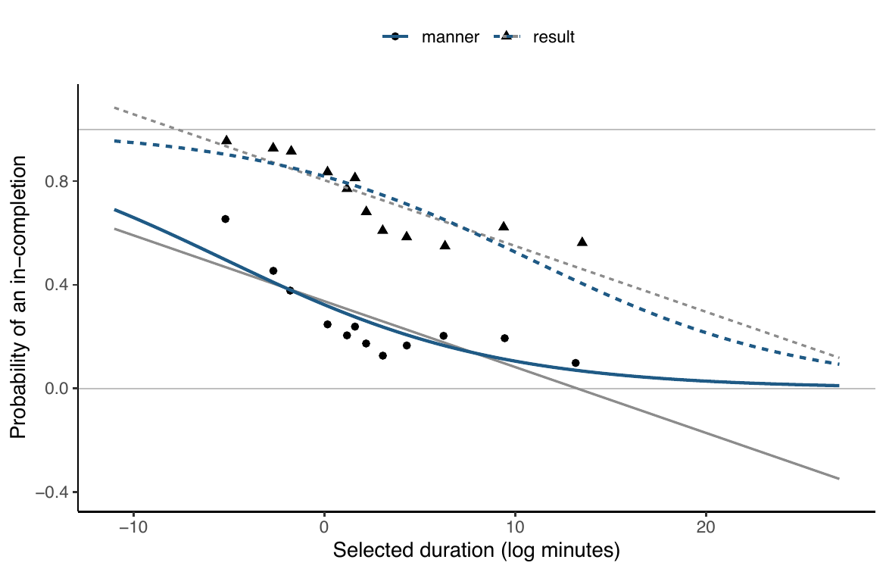
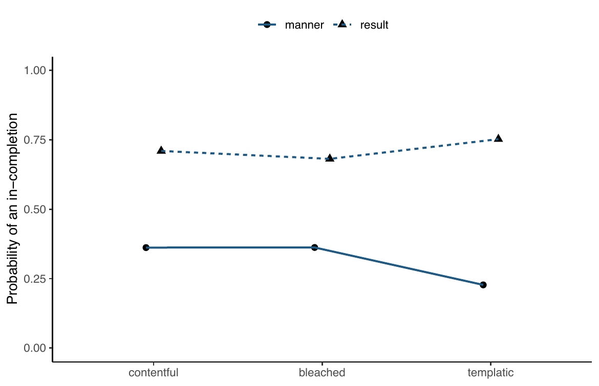
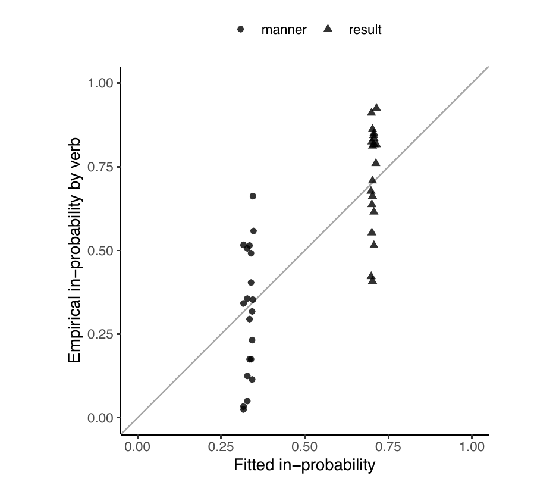
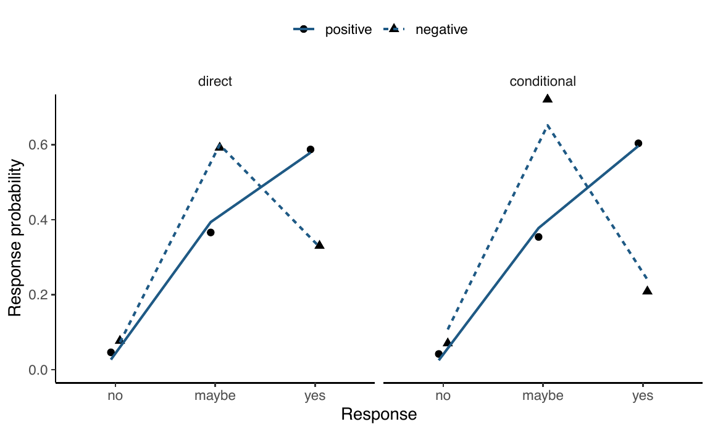
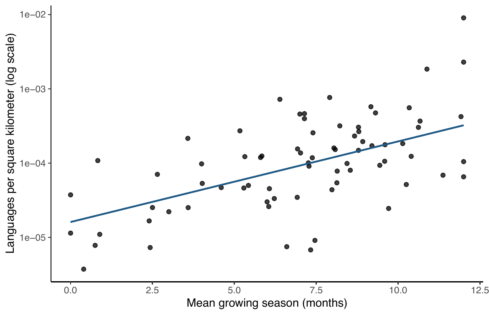
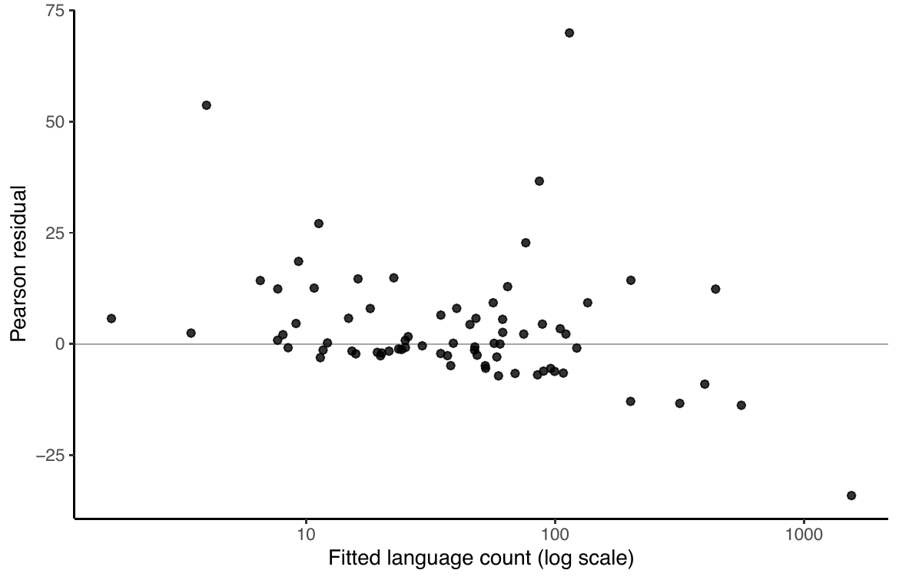
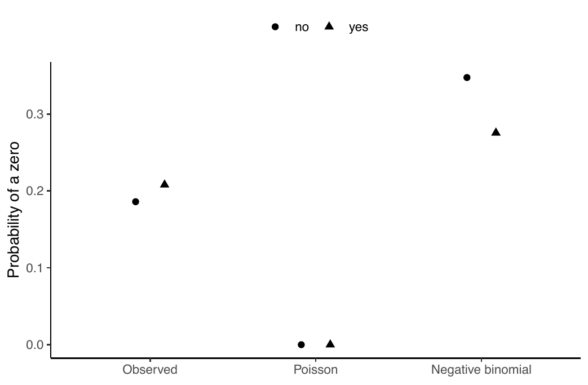
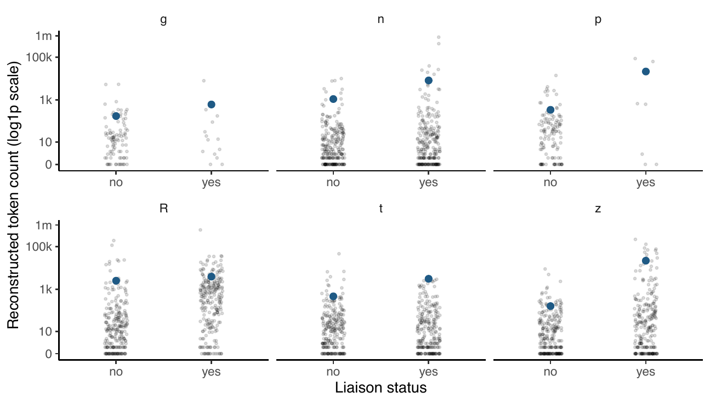
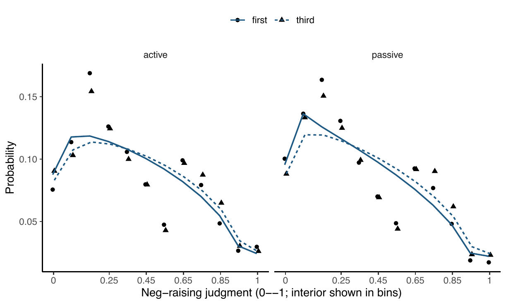
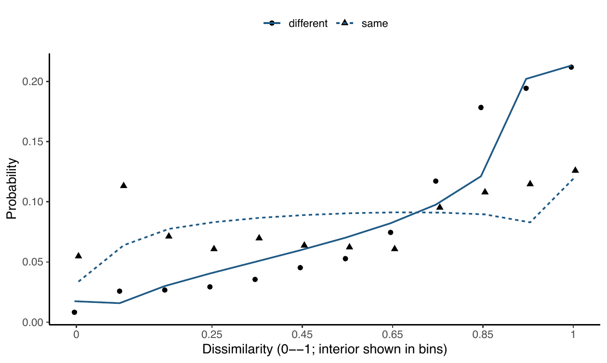

<!-- GENERATED FILE. Rebuild with scripts/rebuild_slides_and_transcripts.py. -->
<!-- The generator does not read the previous deck body; stale slides cannot be retained. -->

<!-- generated-slide-id: generalized-linear-models/why-generalized-linear-models/01-section; notes-page: regression-models/why-generalized-linear-models.qmd; note-sha256: 7e5ff275535ee873b11987c3e2693377ee37f433225d90b2ce7ae4b5c2d39b2c; role: section -->
## When ordinary linear regression cannot model the response {.section-slide}

SuperTelicity cloze release

::: {.notes}
[Transcript]

We now turn to When ordinary linear regression cannot model the response. Ordinary linear regression lets a conditional mean range over the real line and treats residual variance as constant. A binary linguistic response violates both commitments. We can see the problem in the **SuperTelicity cloze data** of White, Cao, Grimm, and Glass's working manuscript, *The preservation of telicity under sense locality* (n.d.).

[Sources]

Course note: regression-models/why-generalized-linear-models.qmd
:::

<!-- generated-slide-id: generalized-linear-models/why-generalized-linear-models/02-dataset; notes-page: regression-models/why-generalized-linear-models.qmd; note-sha256: 7e5ff275535ee873b11987c3e2693377ee37f433225d90b2ce7ae4b5c2d39b2c; role: dataset -->
## SuperTelicity: the empirical object {.compact}

The running data are participant-by-item cloze choices for aspectual inference.

<a href="https://creativecommons.org/licenses/by-sa/4.0/">SuperTelicity cloze release</a>

::: {.notes}
[Transcript]

This is the first use of SuperTelicity in this module. The slide names the observation represented in the teaching table and links the original source. We will keep that unit fixed when we compute and interpret quantities from these data.

[Sources]

Course note: regression-models/why-generalized-linear-models.qmd
:::

<!-- generated-slide-id: generalized-linear-models/why-generalized-linear-models/03-concept; notes-page: regression-models/why-generalized-linear-models.qmd; note-sha256: 7e5ff275535ee873b11987c3e2693377ee37f433225d90b2ce7ae4b5c2d39b2c; role: concept -->
## When ordinary linear regression cannot model the response {.compact}

Ordinary linear regression lets a conditional mean range over the real line and treats residual variance as constant. A binary linguistic response violates both commitments. We can see the problem in the **SuperTelicity cloze data** of White, Cao, Grimm, and Glass's working manuscript, *The preservation of telicity under sense locality* (n.d.).

::: {.notes}
[Transcript]

Ordinary linear regression lets a conditional mean range over the real line and treats residual variance as constant. A binary linguistic response violates both commitments. We can see the problem in the **SuperTelicity cloze data** of White, Cao, Grimm, and Glass's working manuscript, *The preservation of telicity under sense locality* (n.d.). The duration comparison uses only rows with a selected temporal magnitude. Thus it describes observed of the observed cloze choices; missing durations keep it from representing the full experiment. The interpretation is conditional on the sampling and measurement design.

[Sources]

Course note: regression-models/why-generalized-linear-models.qmd
:::

<!-- generated-slide-id: generalized-linear-models/why-generalized-linear-models/04-concept; notes-page: regression-models/why-generalized-linear-models.qmd; note-sha256: 7e5ff275535ee873b11987c3e2693377ee37f433225d90b2ce7ae4b5c2d39b2c; role: concept -->
## The support problem in observed data

For $Y_i=1$ when participant $i$ chooses *in* and $Y_i=0$ otherwise,

::: {.notes}
[Transcript]

For $Y_i=1$ when participant $i$ chooses *in* and $Y_i=0$ otherwise, A linear probability model, $\pi_i=\mathbf x_i^\mathsf T\boldsymbol\beta$, does not constrain $\pi_i$ to $[0,1]$. A logit model instead sets $\operatorname{logit}(\pi_i)=\mathbf x_i^\mathsf T\boldsymbol\beta$. That distinction will matter again on the next slide.

[Sources]

Course note: regression-models/why-generalized-linear-models.qmd
:::

<!-- generated-slide-id: generalized-linear-models/why-generalized-linear-models/05-math; notes-page: regression-models/why-generalized-linear-models.qmd; note-sha256: 7e5ff275535ee873b11987c3e2693377ee37f433225d90b2ce7ae4b5c2d39b2c; role: math -->
## The support problem in observed data {.equation-slide}

$$
\mathbb E(Y_i\mid\mathbf x_i)=\Pr(Y_i=1\mid\mathbf x_i)=\pi_i,
\qquad
\operatorname{Var}(Y_i\mid\mathbf x_i)=\pi_i(1-\pi_i).
$$

::: {.notes}
[Transcript]

The displayed expression formalizes the support problem in observed data. For $Y_i=1$ when participant $i$ chooses *in* and $Y_i=0$ otherwise, Keep track of what each term refers to in the linguistic dataset.

[Sources]

Course note: regression-models/why-generalized-linear-models.qmd
:::

<!-- generated-slide-id: generalized-linear-models/why-generalized-linear-models/06-figure; notes-page: regression-models/why-generalized-linear-models.qmd; note-sha256: 7e5ff275535ee873b11987c3e2693377ee37f433225d90b2ce7ae4b5c2d39b2c; role: figure -->
## When ordinary linear regression cannot model the response {.plot-slide}

{.empirical-plot fig-alt="Observed data and fitted quantities for When ordinary linear regression cannot model the response."}

::: {.notes}
[Transcript]

Start with the axes and the observed values. Observed data and fitted quantities for When ordinary linear regression cannot model the response. Read the pattern before attaching a model interpretation to it.

[Sources]

Course note: regression-models/why-generalized-linear-models.qmd
:::

<!-- generated-slide-id: generalized-linear-models/why-generalized-linear-models/07-figure; notes-page: regression-models/why-generalized-linear-models.qmd; note-sha256: 7e5ff275535ee873b11987c3e2693377ee37f433225d90b2ce7ae4b5c2d39b2c; role: figure -->
## When ordinary linear regression cannot model the response {.plot-slide}

{.empirical-plot fig-alt="Observed data and fitted quantities for When ordinary linear regression cannot model the response."}

::: {.notes}
[Transcript]

Start with the axes and the observed values. Observed data and fitted quantities for When ordinary linear regression cannot model the response. Read the pattern before attaching a model interpretation to it.

[Sources]

Course note: regression-models/why-generalized-linear-models.qmd
:::

<!-- generated-slide-id: generalized-linear-models/why-generalized-linear-models/08-interpretation; notes-page: regression-models/why-generalized-linear-models.qmd; note-sha256: 7e5ff275535ee873b11987c3e2693377ee37f433225d90b2ce7ae4b5c2d39b2c; role: interpretation -->
## Interpretation {.statement-slide}

This is also a variance problem: Bernoulli variance is determined by the mean, rather than by one constant residual variance. A generalized linear model repairs both pieces by choosing a response family with the right support and a link that constrains the mean.

::: {.notes}
[Transcript]

This is also a variance problem: Bernoulli variance is determined by the mean, rather than by one constant residual variance. A generalized linear model repairs both pieces by choosing a response family with the right support and a link that constrains the mean. Notice what is observed and what is supplied by the model.

[Sources]

Course note: regression-models/why-generalized-linear-models.qmd
:::

<!-- generated-slide-id: generalized-linear-models/link-functions/01-section; notes-page: regression-models/link-functions.qmd; note-sha256: de31e2e101de42af6e06e8ca699653f57ce0da3c568661a265f1d0fbacb85479; role: section -->
## Link functions {.section-slide}

SuperTelicity cloze release

::: {.notes}
[Transcript]

We now turn to Link functions. A **link function** maps a constrained conditional mean to the real-valued linear predictor. We continue with SuperTelicity, where the response is an *in* choice and the first-use source and design are introduced on the preceding page.

[Sources]

Course note: regression-models/link-functions.qmd
:::

<!-- generated-slide-id: generalized-linear-models/link-functions/02-concept; notes-page: regression-models/link-functions.qmd; note-sha256: de31e2e101de42af6e06e8ca699653f57ce0da3c568661a265f1d0fbacb85479; role: concept -->
## Link functions

A **link function** maps a constrained conditional mean to the real-valued linear predictor. We continue with SuperTelicity, where the response is an *in* choice and the first-use source and design are introduced on the preceding page.

::: {.notes}
[Transcript]

A **link function** maps a constrained conditional mean to the real-valued linear predictor. We continue with SuperTelicity, where the response is an *in* choice and the first-use source and design are introduced on the preceding page. For a Bernoulli mean $0<\pi_i<1$, the logit link and its inverse are That distinction will matter again on the next slide.

[Sources]

Course note: regression-models/link-functions.qmd
:::

<!-- generated-slide-id: generalized-linear-models/link-functions/03-math; notes-page: regression-models/link-functions.qmd; note-sha256: de31e2e101de42af6e06e8ca699653f57ce0da3c568661a265f1d0fbacb85479; role: math -->
## Overview {.equation-slide}

$$
g(\pi_i)=\log\frac{\pi_i}{1-\pi_i}=\eta_i,
\qquad
g^{-1}(\eta_i)=\frac{1}{1+e^{-\eta_i}}=\pi_i.
$$

::: {.notes}
[Transcript]

The displayed expression formalizes overview. A **link function** maps a constrained conditional mean to the real-valued linear predictor. We continue with SuperTelicity, where the response is an *in* choice and the first-use source and design are introduced on the preceding page. Keep track of what each term refers to in the linguistic dataset.

[Sources]

Course note: regression-models/link-functions.qmd
:::

<!-- generated-slide-id: generalized-linear-models/link-functions/04-concept; notes-page: regression-models/link-functions.qmd; note-sha256: de31e2e101de42af6e06e8ca699653f57ce0da3c568661a265f1d0fbacb85479; role: concept -->
## The inverse link keeps predictions valid {.compact}

The model is additive in $\eta_i$ but curved in $\pi_i$. A constant coefficient is a constant change in log odds, not in probability. The link changes neither the Bernoulli support nor the observed response. It connects the linear predictor to the family mean.

::: {.notes}
[Transcript]

The model is additive in $\eta_i$ but curved in $\pi_i$. A constant coefficient is a constant change in log odds, not in probability. The link changes neither the Bernoulli support nor the observed response. It connects the linear predictor to the family mean. For count means the analogous construction uses $\log\lambda_i=\eta_i$ and $\lambda_i=e^{\eta_i}>0$. Thus the choice of link follows the support of the conditional mean. It is not a device for making a histogram look normal. Now connect the notation back to the linguistic comparison.

[Sources]

Course note: regression-models/link-functions.qmd
:::

<!-- generated-slide-id: generalized-linear-models/link-functions/05-figure; notes-page: regression-models/link-functions.qmd; note-sha256: de31e2e101de42af6e06e8ca699653f57ce0da3c568661a265f1d0fbacb85479; role: figure -->
## Link functions {.plot-slide}

{.empirical-plot fig-alt="Observed data and fitted quantities for Link functions."}

::: {.notes}
[Transcript]

Start with the axes and the observed values. Observed data and fitted quantities for Link functions. Read the pattern before attaching a model interpretation to it.

[Sources]

Course note: regression-models/link-functions.qmd
:::

<!-- generated-slide-id: generalized-linear-models/link-functions/06-interpretation; notes-page: regression-models/link-functions.qmd; note-sha256: de31e2e101de42af6e06e8ca699653f57ce0da3c568661a265f1d0fbacb85479; role: interpretation -->
## Interpretation {.statement-slide}

For count means the analogous construction uses $\log\lambda_i=\eta_i$ and $\lambda_i=e^{\eta_i}>0$. Thus the choice of link follows the support of the conditional mean. It is not a device for making a histogram look normal.

::: {.notes}
[Transcript]

For count means the analogous construction uses $\log\lambda_i=\eta_i$ and $\lambda_i=e^{\eta_i}>0$. Thus the choice of link follows the support of the conditional mean. It is not a device for making a histogram look normal. Notice what is observed and what is supplied by the model.

[Sources]

Course note: regression-models/link-functions.qmd
:::

<!-- generated-slide-id: generalized-linear-models/generalized-linear-models/01-section; notes-page: regression-models/generalized-linear-models.qmd; note-sha256: c65bd518957c0fed70f8783cc56f776d9806201a0fbfe8eab7e9155a468d22d7; role: section -->
## Generalized linear models {.section-slide}

SuperTelicity cloze release

::: {.notes}
[Transcript]

We now turn to Generalized linear models. A **generalized linear model (GLM)** has three distinct parts: (i) a response distribution, (ii) a linear predictor, and (iii) a link between the distribution's conditional mean and that predictor. The SuperTelicity *in* versus *for* response makes each part observable.

[Sources]

Course note: regression-models/generalized-linear-models.qmd
:::

<!-- generated-slide-id: generalized-linear-models/generalized-linear-models/02-concept; notes-page: regression-models/generalized-linear-models.qmd; note-sha256: c65bd518957c0fed70f8783cc56f776d9806201a0fbfe8eab7e9155a468d22d7; role: concept -->
## Generalized linear models {.compact}

A **generalized linear model (GLM)** has three distinct parts: (i) a response distribution, (ii) a linear predictor, and (iii) a link between the distribution's conditional mean and that predictor. The SuperTelicity *in* versus *for* response makes each part observable.

::: {.notes}
[Transcript]

A **generalized linear model (GLM)** has three distinct parts: (i) a response distribution, (ii) a linear predictor, and (iii) a link between the distribution's conditional mean and that predictor. The SuperTelicity *in* versus *for* response makes each part observable. The response component is $Y_i\mid\pi_i\sim\operatorname{Bernoulli}(\pi_i)$, the systematic component is Now connect the notation back to the linguistic comparison.

[Sources]

Course note: regression-models/generalized-linear-models.qmd
:::

<!-- generated-slide-id: generalized-linear-models/generalized-linear-models/03-math; notes-page: regression-models/generalized-linear-models.qmd; note-sha256: c65bd518957c0fed70f8783cc56f776d9806201a0fbfe8eab7e9155a468d22d7; role: math -->
## Overview: equation 1 {.equation-slide}

$$
\eta_i=\beta_0+\beta_1\operatorname{result}_i,
$$

::: {.notes}
[Transcript]

The displayed expression formalizes overview: equation 1. A **generalized linear model (GLM)** has three distinct parts: (i) a response distribution, (ii) a linear predictor, and (iii) a link between the distribution's conditional mean and that predictor. The SuperTelicity *in* versus *for* response makes each part observable. Keep track of what each term refers to in the linguistic dataset.

[Sources]

Course note: regression-models/generalized-linear-models.qmd
:::

<!-- generated-slide-id: generalized-linear-models/generalized-linear-models/04-math; notes-page: regression-models/generalized-linear-models.qmd; note-sha256: c65bd518957c0fed70f8783cc56f776d9806201a0fbfe8eab7e9155a468d22d7; role: math -->
## Overview: equation 2 {.equation-slide}

$$
\log\frac{\pi_i}{1-\pi_i}=\eta_i,
\qquad
\pi_i=\frac{1}{1+\exp[-(\beta_0+\beta_1\operatorname{result}_i)]}.
$$

::: {.notes}
[Transcript]

The displayed expression formalizes overview: equation 2. The response component is $Y_i\mid\pi_i\sim\operatorname{Bernoulli}(\pi_i)$, the systematic component is Keep track of what each term refers to in the linguistic dataset.

[Sources]

Course note: regression-models/generalized-linear-models.qmd
:::

<!-- generated-slide-id: generalized-linear-models/generalized-linear-models/05-figure; notes-page: regression-models/generalized-linear-models.qmd; note-sha256: c65bd518957c0fed70f8783cc56f776d9806201a0fbfe8eab7e9155a468d22d7; role: figure -->
## Generalized linear models {.plot-slide}

{.empirical-plot fig-alt="The population GLM is useful for exposing the machinery. It is not the SuperTelicity paper&#x27;s inferential model, which includes supported participant and item dependence."}

::: {.notes}
[Transcript]

Start with the axes and the observed values. The population GLM is useful for exposing the machinery. It is not the SuperTelicity paper's inferential model, which includes supported participant and item dependence. Read the pattern before attaching a model interpretation to it.

[Sources]

Course note: regression-models/generalized-linear-models.qmd
:::

<!-- generated-slide-id: generalized-linear-models/generalized-linear-models/06-interpretation; notes-page: regression-models/generalized-linear-models.qmd; note-sha256: c65bd518957c0fed70f8783cc56f776d9806201a0fbfe8eab7e9155a468d22d7; role: interpretation -->
## Interpretation {.statement-slide}

The population GLM is useful for exposing the machinery. It is not the SuperTelicity paper's inferential model, which includes supported participant and item dependence.

::: {.notes}
[Transcript]

The population GLM is useful for exposing the machinery. It is not the SuperTelicity paper's inferential model, which includes supported participant and item dependence. The interpretation is conditional on the sampling and measurement design.

[Sources]

Course note: regression-models/generalized-linear-models.qmd
:::

<!-- generated-slide-id: generalized-linear-models/exponential-family/01-section; notes-page: regression-models/exponential-family.qmd; note-sha256: 117d00e733d643a0c3ed498baa3e79e3871455aa662564e065e364d00e498843; role: section -->
## The exponential family {.section-slide}

SuperTelicity cloze release

::: {.notes}
[Transcript]

We now turn to The exponential family. Many GLM response distributions share the **exponential-family form**

[Sources]

Course note: regression-models/exponential-family.qmd
:::

<!-- generated-slide-id: generalized-linear-models/exponential-family/02-concept; notes-page: regression-models/exponential-family.qmd; note-sha256: 117d00e733d643a0c3ed498baa3e79e3871455aa662564e065e364d00e498843; role: concept -->
## The exponential family

Many GLM response distributions share the **exponential-family form**

::: {.notes}
[Transcript]

Many GLM response distributions share the **exponential-family form** Here $\theta$ is the canonical parameter, $b(\theta)$ determines the mean and variance, and $\phi$ supplies dispersion when the family has one. To make those roles concrete, we derive the Bernoulli member from the observed SuperTelicity choices. The interpretation is conditional on the sampling and measurement design.

[Sources]

Course note: regression-models/exponential-family.qmd
:::

<!-- generated-slide-id: generalized-linear-models/exponential-family/03-math; notes-page: regression-models/exponential-family.qmd; note-sha256: 117d00e733d643a0c3ed498baa3e79e3871455aa662564e065e364d00e498843; role: math -->
## Overview: equation 1 {.equation-slide}

$$
p(y\mid\theta,\phi)=\exp\left\{\frac{y\theta-b(\theta)}{a(\phi)}+c(y,\phi)\right\}.
$$

::: {.notes}
[Transcript]

The displayed expression formalizes overview: equation 1. Many GLM response distributions share the **exponential-family form** Keep track of what each term refers to in the linguistic dataset.

[Sources]

Course note: regression-models/exponential-family.qmd
:::

<!-- generated-slide-id: generalized-linear-models/exponential-family/04-math; notes-page: regression-models/exponential-family.qmd; note-sha256: 117d00e733d643a0c3ed498baa3e79e3871455aa662564e065e364d00e498843; role: math -->
## Overview: equation 2 {.equation-slide}

$$
p(y_i\mid\pi_i)=\pi_i^{y_i}(1-\pi_i)^{1-y_i}.
$$

::: {.notes}
[Transcript]

The displayed expression formalizes overview: equation 2. Here $\theta$ is the canonical parameter, $b(\theta)$ determines the mean and variance, and $\phi$ supplies dispersion when the family has one. To make those roles concrete, we derive the Bernoulli member from the observed SuperTelicity choices. Keep track of what each term refers to in the linguistic dataset.

[Sources]

Course note: regression-models/exponential-family.qmd
:::

<!-- generated-slide-id: generalized-linear-models/exponential-family/05-math; notes-page: regression-models/exponential-family.qmd; note-sha256: 117d00e733d643a0c3ed498baa3e79e3871455aa662564e065e364d00e498843; role: math -->
## Overview: equation 3 {.equation-slide}

$$
\log p(y_i\mid\theta_i)=y_i\theta_i-\log(1+e^{\theta_i}).
$$

::: {.notes}
[Transcript]

The displayed expression formalizes overview: equation 3. For $y_i\in\{0,1\}$, Keep track of what each term refers to in the linguistic dataset.

[Sources]

Course note: regression-models/exponential-family.qmd
:::

<!-- generated-slide-id: generalized-linear-models/exponential-family/06-interpretation; notes-page: regression-models/exponential-family.qmd; note-sha256: 117d00e733d643a0c3ed498baa3e79e3871455aa662564e065e364d00e498843; role: interpretation -->
## Interpretation {.statement-slide}

The shared form links distributions to GLM computation, but it does not make the families interchangeable. Bernoulli, Poisson, and normal models retain different supports and mean-variance relations. The exponential-family notation organizes those distinctions; it does not remove them.

::: {.notes}
[Transcript]

The shared form links distributions to GLM computation, but it does not make the families interchangeable. Bernoulli, Poisson, and normal models retain different supports and mean-variance relations. The exponential-family notation organizes those distinctions; it does not remove them. That distinction will matter again on the next slide.

[Sources]

Course note: regression-models/exponential-family.qmd
:::

<!-- generated-slide-id: generalized-linear-models/sufficient-statistics/01-section; notes-page: regression-models/sufficient-statistics.qmd; note-sha256: dda6f31ba9bdfa8c79a4fdac6e5573701a7e350c104435a608f51c1e5dc4d9ae; role: section -->
## Sufficient statistics {.section-slide}

SuperTelicity cloze release

::: {.notes}
[Transcript]

We now turn to Sufficient statistics. A statistic is **sufficient** for a parameter when, under the stated model, it retains all sample information about that parameter. For an intercept-only Bernoulli model of the SuperTelicity choices, the sufficient information is the row count and number of *in* responses.

[Sources]

Course note: regression-models/sufficient-statistics.qmd
:::

<!-- generated-slide-id: generalized-linear-models/sufficient-statistics/02-concept; notes-page: regression-models/sufficient-statistics.qmd; note-sha256: dda6f31ba9bdfa8c79a4fdac6e5573701a7e350c104435a608f51c1e5dc4d9ae; role: concept -->
## Sufficient statistics {.compact}

A statistic is **sufficient** for a parameter when, under the stated model, it retains all sample information about that parameter. For an intercept-only Bernoulli model of the SuperTelicity choices, the sufficient information is the row count and number of *in* responses.

::: {.notes}
[Transcript]

A statistic is **sufficient** for a parameter when, under the stated model, it retains all sample information about that parameter. For an intercept-only Bernoulli model of the SuperTelicity choices, the sufficient information is the row count and number of *in* responses. The joint likelihood is Use the graph or equation to say the result in ordinary language.

[Sources]

Course note: regression-models/sufficient-statistics.qmd
:::

<!-- generated-slide-id: generalized-linear-models/sufficient-statistics/03-math; notes-page: regression-models/sufficient-statistics.qmd; note-sha256: dda6f31ba9bdfa8c79a4fdac6e5573701a7e350c104435a608f51c1e5dc4d9ae; role: math -->
## Overview {.equation-slide}

$$
L(\pi;\mathbf y)=\prod_{i=1}^{n}\pi^{y_i}(1-\pi)^{1-y_i}
=\pi^{\sum_i y_i}(1-\pi)^{n-\sum_i y_i}.
$$

::: {.notes}
[Transcript]

The displayed expression formalizes overview. A statistic is **sufficient** for a parameter when, under the stated model, it retains all sample information about that parameter. For an intercept-only Bernoulli model of the SuperTelicity choices, the sufficient information is the row count and number of *in* responses. Keep track of what each term refers to in the linguistic dataset.

[Sources]

Course note: regression-models/sufficient-statistics.qmd
:::

<!-- generated-slide-id: generalized-linear-models/sufficient-statistics/04-interpretation; notes-page: regression-models/sufficient-statistics.qmd; note-sha256: dda6f31ba9bdfa8c79a4fdac6e5573701a7e350c104435a608f51c1e5dc4d9ae; role: interpretation -->
## Interpretation {.statement-slide}

This compression is model-specific. Once verb type, contentfulness, participant, or sentence enters the model, the allocation of responses across those units matters. Sufficiency for one intercept thus does not license deleting participant and sentence identifiers.

::: {.notes}
[Transcript]

This compression is model-specific. Once verb type, contentfulness, participant, or sentence enters the model, the allocation of responses across those units matters. Sufficiency for one intercept thus does not license deleting participant and sentence identifiers. Use the graph or equation to say the result in ordinary language.

[Sources]

Course note: regression-models/sufficient-statistics.qmd
:::

<!-- generated-slide-id: generalized-linear-models/iteratively-reweighted-least-squares/01-section; notes-page: regression-models/iteratively-reweighted-least-squares.qmd; note-sha256: c6fa42870a9c4e328bda2a83d6179f04646bc2ab8d67cfe53c51976e103baafa; role: section -->
## Iteratively reweighted least squares {.section-slide}

SuperTelicity cloze release

::: {.notes}
[Transcript]

We now turn to Iteratively reweighted least squares. Logistic regression has no ordinary least-squares solution because the inverse logit makes the likelihood nonlinear in the coefficients. **Iteratively reweighted least squares (IRLS)** solves a sequence of local weighted least-squares problems. We can follow that sequence for the SuperTelicity verb-type model.

[Sources]

Course note: regression-models/iteratively-reweighted-least-squares.qmd
:::

<!-- generated-slide-id: generalized-linear-models/iteratively-reweighted-least-squares/02-concept; notes-page: regression-models/iteratively-reweighted-least-squares.qmd; note-sha256: c6fa42870a9c4e328bda2a83d6179f04646bc2ab8d67cfe53c51976e103baafa; role: concept -->
## Iteratively reweighted least squares {.compact}

Logistic regression has no ordinary least-squares solution because the inverse logit makes the likelihood nonlinear in the coefficients. **Iteratively reweighted least squares (IRLS)** solves a sequence of local weighted least-squares problems. We can follow that sequence for the SuperTelicity verb-type model.

::: {.notes}
[Transcript]

Logistic regression has no ordinary least-squares solution because the inverse logit makes the likelihood nonlinear in the coefficients. **Iteratively reweighted least squares (IRLS)** solves a sequence of local weighted least-squares problems. We can follow that sequence for the SuperTelicity verb-type model. At iteration $t$, let Keep the observational unit fixed while you interpret the result.

[Sources]

Course note: regression-models/iteratively-reweighted-least-squares.qmd
:::

<!-- generated-slide-id: generalized-linear-models/iteratively-reweighted-least-squares/03-math; notes-page: regression-models/iteratively-reweighted-least-squares.qmd; note-sha256: c6fa42870a9c4e328bda2a83d6179f04646bc2ab8d67cfe53c51976e103baafa; role: math -->
## Overview: equation 1 {.equation-slide}

$$
\boldsymbol\eta^{(t)}=\mathbf X\boldsymbol\beta^{(t)},\quad
\boldsymbol\mu^{(t)}=\operatorname{logit}^{-1}(\boldsymbol\eta^{(t)}),
$$

::: {.notes}
[Transcript]

The displayed expression formalizes overview: equation 1. Logistic regression has no ordinary least-squares solution because the inverse logit makes the likelihood nonlinear in the coefficients. **Iteratively reweighted least squares (IRLS)** solves a sequence of local weighted least-squares problems. We can follow that sequence for the SuperTelicity verb-type model. Keep track of what each term refers to in the linguistic dataset.

[Sources]

Course note: regression-models/iteratively-reweighted-least-squares.qmd
:::

<!-- generated-slide-id: generalized-linear-models/iteratively-reweighted-least-squares/04-math; notes-page: regression-models/iteratively-reweighted-least-squares.qmd; note-sha256: c6fa42870a9c4e328bda2a83d6179f04646bc2ab8d67cfe53c51976e103baafa; role: math -->
## Overview: equation 2 {.equation-slide}

$$
w_i^{(t)}=\mu_i^{(t)}[1-\mu_i^{(t)}],\quad
z_i^{(t)}=\eta_i^{(t)}+\frac{y_i-\mu_i^{(t)}}{w_i^{(t)}}.
$$

::: {.notes}
[Transcript]

The displayed expression formalizes overview: equation 2. At iteration $t$, let Keep track of what each term refers to in the linguistic dataset.

[Sources]

Course note: regression-models/iteratively-reweighted-least-squares.qmd
:::

<!-- generated-slide-id: generalized-linear-models/iteratively-reweighted-least-squares/05-math; notes-page: regression-models/iteratively-reweighted-least-squares.qmd; note-sha256: c6fa42870a9c4e328bda2a83d6179f04646bc2ab8d67cfe53c51976e103baafa; role: math -->
## Overview: equation 3 {.equation-slide}

$$
\boldsymbol\beta^{(t+1)}=(\mathbf X^\mathsf T\mathbf W^{(t)}\mathbf X)^{-1}
\mathbf X^\mathsf T\mathbf W^{(t)}\mathbf z^{(t)}.
$$

::: {.notes}
[Transcript]

The displayed expression formalizes overview: equation 3. The update is Keep track of what each term refers to in the linguistic dataset.

[Sources]

Course note: regression-models/iteratively-reweighted-least-squares.qmd
:::

<!-- generated-slide-id: generalized-linear-models/iteratively-reweighted-least-squares/06-figure; notes-page: regression-models/iteratively-reweighted-least-squares.qmd; note-sha256: c6fa42870a9c4e328bda2a83d6179f04646bc2ab8d67cfe53c51976e103baafa; role: figure -->
## Iteratively reweighted least squares {.plot-slide}

{.empirical-plot fig-alt="The plotted path records successive local weighted-least-squares solutions. The working response $\mathbf z$ is algorithmic, whereas the observed response remains the original vector of *in* and *for* choices; the final coefficients agree with `glm()` to the asserted tolerance."}

::: {.notes}
[Transcript]

Start with the axes and the observed values. The plotted path records successive local weighted-least-squares solutions. The working response $\mathbf z$ is algorithmic, whereas the observed response remains the original vector of *in* and *for* choices; the final coefficients agree with `glm()` to the asserted tolerance. Read the pattern before attaching a model interpretation to it.

[Sources]

Course note: regression-models/iteratively-reweighted-least-squares.qmd
:::

<!-- generated-slide-id: generalized-linear-models/iteratively-reweighted-least-squares/07-figure; notes-page: regression-models/iteratively-reweighted-least-squares.qmd; note-sha256: c6fa42870a9c4e328bda2a83d6179f04646bc2ab8d67cfe53c51976e103baafa; role: figure -->
## Iteratively reweighted least squares {.plot-slide}

{.empirical-plot fig-alt="Observed data and fitted quantities for Iteratively reweighted least squares."}

::: {.notes}
[Transcript]

Start with the axes and the observed values. Observed data and fitted quantities for Iteratively reweighted least squares. Read the pattern before attaching a model interpretation to it.

[Sources]

Course note: regression-models/iteratively-reweighted-least-squares.qmd
:::

<!-- generated-slide-id: generalized-linear-models/deviance/01-section; notes-page: regression-models/deviance.qmd; note-sha256: 2172c0d3be943fa2271dc62614f81981870da50099f61e46dac2a6ae5e1a163b; role: section -->
## Deviance {.section-slide}

SuperTelicity cloze release

::: {.notes}
[Transcript]

We now turn to Deviance. **Deviance** measures how far a fitted likelihood is from the saturated model, which assigns one fitted mean to each observation. If $\ell(\widehat\theta)$ is the fitted log likelihood and $\ell_{\mathrm{sat}}$ is the saturated log likelihood,

[Sources]

Course note: regression-models/deviance.qmd
:::

<!-- generated-slide-id: generalized-linear-models/deviance/02-concept; notes-page: regression-models/deviance.qmd; note-sha256: 2172c0d3be943fa2271dc62614f81981870da50099f61e46dac2a6ae5e1a163b; role: concept -->
## Deviance

**Deviance** measures how far a fitted likelihood is from the saturated model, which assigns one fitted mean to each observation. If $\ell(\widehat\theta)$ is the fitted log likelihood and $\ell_{\mathrm{sat}}$ is the saturated log likelihood,

::: {.notes}
[Transcript]

**Deviance** measures how far a fitted likelihood is from the saturated model, which assigns one fitted mean to each observation. If $\ell(\widehat\theta)$ is the fitted log likelihood and $\ell_{\mathrm{sat}}$ is the saturated log likelihood, For Bernoulli rows, the saturated contribution is zero, so residual deviance is $-2\ell(\widehat\theta)$. We compare four population models for the same SuperTelicity rows. That distinction will matter again on the next slide.

[Sources]

Course note: regression-models/deviance.qmd
:::

<!-- generated-slide-id: generalized-linear-models/deviance/03-math; notes-page: regression-models/deviance.qmd; note-sha256: 2172c0d3be943fa2271dc62614f81981870da50099f61e46dac2a6ae5e1a163b; role: math -->
## Overview: equation 1 {.equation-slide}

$$
D=2\{\ell_{\mathrm{sat}}-\ell(\widehat\theta)\}.
$$

::: {.notes}
[Transcript]

The displayed expression formalizes overview: equation 1. **Deviance** measures how far a fitted likelihood is from the saturated model, which assigns one fitted mean to each observation. If $\ell(\widehat\theta)$ is the fitted log likelihood and $\ell_{\mathrm{sat}}$ is the saturated log likelihood, Keep track of what each term refers to in the linguistic dataset.

[Sources]

Course note: regression-models/deviance.qmd
:::

<!-- generated-slide-id: generalized-linear-models/deviance/04-math; notes-page: regression-models/deviance.qmd; note-sha256: 2172c0d3be943fa2271dc62614f81981870da50099f61e46dac2a6ae5e1a163b; role: math -->
## Overview: equation 2 {.equation-slide}

$$
\Delta D=2\{\ell(\widehat\theta_{\mathrm{larger}})-
\ell(\widehat\theta_{\mathrm{smaller}})\}.
$$

::: {.notes}
[Transcript]

The displayed expression formalizes overview: equation 2. For Bernoulli rows, the saturated contribution is zero, so residual deviance is $-2\ell(\widehat\theta)$. We compare four population models for the same SuperTelicity rows. Keep track of what each term refers to in the linguistic dataset.

[Sources]

Course note: regression-models/deviance.qmd
:::

<!-- generated-slide-id: generalized-linear-models/deviance/05-figure; notes-page: regression-models/deviance.qmd; note-sha256: 2172c0d3be943fa2271dc62614f81981870da50099f61e46dac2a6ae5e1a163b; role: figure -->
## Deviance {.plot-slide}

{.empirical-plot fig-alt="It is a likelihood-ratio statistic under the usual regularity conditions. The sequence shows how much each added structure improves row-level fit."}

::: {.notes}
[Transcript]

Start with the axes and the observed values. It is a likelihood-ratio statistic under the usual regularity conditions. The sequence shows how much each added structure improves row-level fit. Read the pattern before attaching a model interpretation to it.

[Sources]

Course note: regression-models/deviance.qmd
:::

<!-- generated-slide-id: generalized-linear-models/odds-and-log-odds/01-section; notes-page: regression-models/odds-and-log-odds.qmd; note-sha256: d54bdf33ff05c4518b25a18993e2597b0ffc45224924d641024464219f98d4e4; role: section -->
## Odds and log odds {.section-slide}

SuperTelicity cloze release

::: {.notes}
[Transcript]

We now turn to Odds and log odds. For a probability $p$, the **odds** and **log odds** are

[Sources]

Course note: regression-models/odds-and-log-odds.qmd
:::

<!-- generated-slide-id: generalized-linear-models/odds-and-log-odds/02-concept; notes-page: regression-models/odds-and-log-odds.qmd; note-sha256: d54bdf33ff05c4518b25a18993e2597b0ffc45224924d641024464219f98d4e4; role: concept -->
## Odds and log odds

For a probability $p$, the **odds** and **log odds** are

::: {.notes}
[Transcript]

For a probability $p$, the **odds** and **log odds** are Their interpretation is easiest to anchor in the observed SuperTelicity group probabilities. Notice what is observed and what is supplied by the model.

[Sources]

Course note: regression-models/odds-and-log-odds.qmd
:::

<!-- generated-slide-id: generalized-linear-models/odds-and-log-odds/03-math; notes-page: regression-models/odds-and-log-odds.qmd; note-sha256: d54bdf33ff05c4518b25a18993e2597b0ffc45224924d641024464219f98d4e4; role: math -->
## Overview {.equation-slide}

$$
\operatorname{odds}(p)=\frac{p}{1-p},
\qquad
\operatorname{logit}(p)=\log\frac{p}{1-p}.
$$

::: {.notes}
[Transcript]

The displayed expression formalizes overview. For a probability $p$, the **odds** and **log odds** are Keep track of what each term refers to in the linguistic dataset.

[Sources]

Course note: regression-models/odds-and-log-odds.qmd
:::

<!-- generated-slide-id: generalized-linear-models/odds-and-log-odds/04-interpretation; notes-page: regression-models/odds-and-log-odds.qmd; note-sha256: d54bdf33ff05c4518b25a18993e2597b0ffc45224924d641024464219f98d4e4; role: interpretation -->
## Interpretation {.statement-slide}

Log odds are unbounded and additive, which is why logistic regression uses them. Probabilities remain the scale for substantive interpretation. The PS3 page applies this distinction to fitted contrasts.

::: {.notes}
[Transcript]

Log odds are unbounded and additive, which is why logistic regression uses them. Probabilities remain the scale for substantive interpretation. The PS3 page applies this distinction to fitted contrasts. Now connect the notation back to the linguistic comparison.

[Sources]

Course note: regression-models/odds-and-log-odds.qmd
:::

<!-- generated-slide-id: generalized-linear-models/logistic-regression/01-section; notes-page: regression-models/logistic-regression.qmd; note-sha256: 135c44e7ccbac37ea71c431798423ae5305cca32e4e8644016604df5f74d2b9f; role: section -->
## Logistic regression {.section-slide}

SuperTelicity cloze release

::: {.notes}
[Transcript]

We now turn to Logistic regression. Logistic regression combines a Bernoulli response with the logit link. For the SuperTelicity verb-type contrast,

[Sources]

Course note: regression-models/logistic-regression.qmd
:::

<!-- generated-slide-id: generalized-linear-models/logistic-regression/02-concept; notes-page: regression-models/logistic-regression.qmd; note-sha256: 135c44e7ccbac37ea71c431798423ae5305cca32e4e8644016604df5f74d2b9f; role: concept -->
## Logistic regression

Logistic regression combines a Bernoulli response with the logit link. For the SuperTelicity verb-type contrast,

::: {.notes}
[Transcript]

Logistic regression combines a Bernoulli response with the logit link. For the SuperTelicity verb-type contrast, The intercept is the manner-verb log odds. The result coefficient is the result-minus-manner log odds difference, so Notice what is observed and what is supplied by the model.

[Sources]

Course note: regression-models/logistic-regression.qmd
:::

<!-- generated-slide-id: generalized-linear-models/logistic-regression/03-math; notes-page: regression-models/logistic-regression.qmd; note-sha256: 135c44e7ccbac37ea71c431798423ae5305cca32e4e8644016604df5f74d2b9f; role: math -->
## Overview: equation 1 {.equation-slide}

$$
Y_i\sim\operatorname{Bernoulli}(\pi_i),
\qquad
\log\frac{\pi_i}{1-\pi_i}=\beta_0+\beta_1\operatorname{result}_i.
$$

::: {.notes}
[Transcript]

The displayed expression formalizes overview: equation 1. Logistic regression combines a Bernoulli response with the logit link. For the SuperTelicity verb-type contrast, Keep track of what each term refers to in the linguistic dataset.

[Sources]

Course note: regression-models/logistic-regression.qmd
:::

<!-- generated-slide-id: generalized-linear-models/logistic-regression/04-math; notes-page: regression-models/logistic-regression.qmd; note-sha256: 135c44e7ccbac37ea71c431798423ae5305cca32e4e8644016604df5f74d2b9f; role: math -->
## Overview: equation 2 {.equation-slide}

$$
e^{\beta_1}
=\frac{\pi_{\mathrm{result}}/(1-\pi_{\mathrm{result}})}
        {\pi_{\mathrm{manner}}/(1-\pi_{\mathrm{manner}})}.
$$

::: {.notes}
[Transcript]

The displayed expression formalizes overview: equation 2. The intercept is the manner-verb log odds. The result coefficient is the result-minus-manner log odds difference, so Keep track of what each term refers to in the linguistic dataset.

[Sources]

Course note: regression-models/logistic-regression.qmd
:::

<!-- generated-slide-id: generalized-linear-models/logistic-regression/05-figure; notes-page: regression-models/logistic-regression.qmd; note-sha256: 135c44e7ccbac37ea71c431798423ae5305cca32e4e8644016604df5f74d2b9f; role: figure -->
## Logistic regression {.plot-slide}

{.empirical-plot fig-alt="This population model remains a teaching simplification. The SuperTelicity analysis uses a Bayesian logistic mixed model; repeated participants and sentences make the row-independent standard errors here unsuitable for confirmatory inference."}

::: {.notes}
[Transcript]

Start with the axes and the observed values. This population model remains a teaching simplification. The SuperTelicity analysis uses a Bayesian logistic mixed model; repeated participants and sentences make the row-independent standard errors here unsuitable for confirmatory inference. Read the pattern before attaching a model interpretation to it.

[Sources]

Course note: regression-models/logistic-regression.qmd
:::

<!-- generated-slide-id: generalized-linear-models/logistic-regression-example/01-section; notes-page: regression-models/logistic-regression-example.qmd; note-sha256: 4f7820f8dc6eb3df9ac243743d658beeed272b95066abf06d39793dd0b860123; role: section -->
## A logistic-regression analysis {.section-slide}

SuperTelicity cloze release

::: {.notes}
[Transcript]

We now turn to A logistic-regression analysis. We now carry the SuperTelicity one-predictor analysis from raw counts to fitted probabilities. The scientific question is descriptive: how does *in* completion use differ between manner and result verbs in this sample?

[Sources]

Course note: regression-models/logistic-regression-example.qmd
:::

<!-- generated-slide-id: generalized-linear-models/logistic-regression-example/02-concept; notes-page: regression-models/logistic-regression-example.qmd; note-sha256: 4f7820f8dc6eb3df9ac243743d658beeed272b95066abf06d39793dd0b860123; role: concept -->
## A logistic-regression analysis

We now carry the SuperTelicity one-predictor analysis from raw counts to fitted probabilities. The scientific question is descriptive: how does *in* completion use differ between manner and result verbs in this sample?

::: {.notes}
[Transcript]

We now carry the SuperTelicity one-predictor analysis from raw counts to fitted probabilities. The scientific question is descriptive: how does *in* completion use differ between manner and result verbs in this sample? The fit reproduces the higher sample probability for result verbs, and the plot places that raw contrast beside the row-independent GLM intervals. On the link scale, the likelihood is Now connect the notation back to the linguistic comparison.

[Sources]

Course note: regression-models/logistic-regression-example.qmd
:::

<!-- generated-slide-id: generalized-linear-models/logistic-regression-example/03-math; notes-page: regression-models/logistic-regression-example.qmd; note-sha256: 4f7820f8dc6eb3df9ac243743d658beeed272b95066abf06d39793dd0b860123; role: math -->
## Overview {.equation-slide}

$$
\ell(\boldsymbol\beta)=\sum_i\left[y_i\eta_i-
\log(1+e^{\eta_i})\right],
\qquad \eta_i=\beta_0+\beta_1\operatorname{result}_i.
$$

::: {.notes}
[Transcript]

The displayed expression formalizes overview. We now carry the SuperTelicity one-predictor analysis from raw counts to fitted probabilities. The scientific question is descriptive: how does *in* completion use differ between manner and result verbs in this sample? Keep track of what each term refers to in the linguistic dataset.

[Sources]

Course note: regression-models/logistic-regression-example.qmd
:::

<!-- generated-slide-id: generalized-linear-models/logistic-regression-example/04-figure; notes-page: regression-models/logistic-regression-example.qmd; note-sha256: 4f7820f8dc6eb3df9ac243743d658beeed272b95066abf06d39793dd0b860123; role: figure -->
## A logistic-regression analysis {.plot-slide}

{.empirical-plot fig-alt="The intervals shown are the row-independent GLM intervals and are included to expose the mechanics. They are not the inferential result of the source paper."}

::: {.notes}
[Transcript]

Start with the axes and the observed values. The intervals shown are the row-independent GLM intervals and are included to expose the mechanics. They are not the inferential result of the source paper. Read the pattern before attaching a model interpretation to it.

[Sources]

Course note: regression-models/logistic-regression-example.qmd
:::

<!-- generated-slide-id: generalized-linear-models/logistic-regression-example/05-figure; notes-page: regression-models/logistic-regression-example.qmd; note-sha256: 4f7820f8dc6eb3df9ac243743d658beeed272b95066abf06d39793dd0b860123; role: figure -->
## A logistic-regression analysis {.plot-slide}

{.empirical-plot fig-alt="Observed data and fitted quantities for A logistic-regression analysis."}

::: {.notes}
[Transcript]

Start with the axes and the observed values. Observed data and fitted quantities for A logistic-regression analysis. Read the pattern before attaching a model interpretation to it.

[Sources]

Course note: regression-models/logistic-regression-example.qmd
:::

<!-- generated-slide-id: generalized-linear-models/logistic-regression-example/06-interpretation; notes-page: regression-models/logistic-regression-example.qmd; note-sha256: 4f7820f8dc6eb3df9ac243743d658beeed272b95066abf06d39793dd0b860123; role: interpretation -->
## Interpretation {.statement-slide}

The intervals shown are the row-independent GLM intervals and are included to expose the mechanics. They are not the inferential result of the source paper. The rows reuse participants and sentence materials, and the original analysis models that dependence.

::: {.notes}
[Transcript]

The intervals shown are the row-independent GLM intervals and are included to expose the mechanics. They are not the inferential result of the source paper. The rows reuse participants and sentence materials, and the original analysis models that dependence. Notice what is observed and what is supplied by the model.

[Sources]

Course note: regression-models/logistic-regression-example.qmd
:::

<!-- generated-slide-id: generalized-linear-models/logistic-regression-with-multiple-predictors/01-section; notes-page: regression-models/logistic-regression-with-multiple-predictors.qmd; note-sha256: cdd96f12b7521a39315f6136dd90af6f16891a6d88a142bc9f7d41d29bd76356; role: section -->
## Logistic regression with multiple predictors {.section-slide}

SuperTelicity cloze release

::: {.notes}
[Transcript]

We now turn to Logistic regression with multiple predictors. Multiple-predictor logistic regression can represent whether the SuperTelicity verb-type contrast changes across contentfulness classes. The additive model states one common verb-type log odds difference; the interaction model allows it to vary.

[Sources]

Course note: regression-models/logistic-regression-with-multiple-predictors.qmd
:::

<!-- generated-slide-id: generalized-linear-models/logistic-regression-with-multiple-predictors/02-concept; notes-page: regression-models/logistic-regression-with-multiple-predictors.qmd; note-sha256: cdd96f12b7521a39315f6136dd90af6f16891a6d88a142bc9f7d41d29bd76356; role: concept -->
## Logistic regression with multiple predictors

Multiple-predictor logistic regression can represent whether the SuperTelicity verb-type contrast changes across contentfulness classes. The additive model states one common verb-type log odds difference; the interaction model allows it to vary.

::: {.notes}
[Transcript]

Multiple-predictor logistic regression can represent whether the SuperTelicity verb-type contrast changes across contentfulness classes. The additive model states one common verb-type log odds difference; the interaction model allows it to vary. The additive linear predictor is Use the graph or equation to say the result in ordinary language.

[Sources]

Course note: regression-models/logistic-regression-with-multiple-predictors.qmd
:::

<!-- generated-slide-id: generalized-linear-models/logistic-regression-with-multiple-predictors/03-math; notes-page: regression-models/logistic-regression-with-multiple-predictors.qmd; note-sha256: cdd96f12b7521a39315f6136dd90af6f16891a6d88a142bc9f7d41d29bd76356; role: math -->
## Overview {.equation-slide}

$$
\eta_i=\beta_0+\beta_1\operatorname{result}_i+
\beta_2\operatorname{bleached}_i+
\beta_3\operatorname{templatic}_i.
$$

::: {.notes}
[Transcript]

The displayed expression formalizes overview. Multiple-predictor logistic regression can represent whether the SuperTelicity verb-type contrast changes across contentfulness classes. The additive model states one common verb-type log odds difference; the interaction model allows it to vary. Keep track of what each term refers to in the linguistic dataset.

[Sources]

Course note: regression-models/logistic-regression-with-multiple-predictors.qmd
:::

<!-- generated-slide-id: generalized-linear-models/logistic-regression-with-multiple-predictors/04-figure; notes-page: regression-models/logistic-regression-with-multiple-predictors.qmd; note-sha256: cdd96f12b7521a39315f6136dd90af6f16891a6d88a142bc9f7d41d29bd76356; role: figure -->
## Logistic regression with multiple predictors {.plot-slide}

{.empirical-plot fig-alt="A partial coefficient is meaningful only because the observed design supplies overlap among the represented cells. This population model still omits participant and sentence dependence and does not replace the paper&#x27;s mixed analysis."}

::: {.notes}
[Transcript]

Start with the axes and the observed values. A partial coefficient is meaningful only because the observed design supplies overlap among the represented cells. This population model still omits participant and sentence dependence and does not replace the paper's mixed analysis. Read the pattern before attaching a model interpretation to it.

[Sources]

Course note: regression-models/logistic-regression-with-multiple-predictors.qmd
:::

<!-- generated-slide-id: generalized-linear-models/logistic-regression-with-multiple-predictors/05-figure; notes-page: regression-models/logistic-regression-with-multiple-predictors.qmd; note-sha256: cdd96f12b7521a39315f6136dd90af6f16891a6d88a142bc9f7d41d29bd76356; role: figure -->
## Logistic regression with multiple predictors {.plot-slide}

{.empirical-plot fig-alt="Observed data and fitted quantities for Logistic regression with multiple predictors."}

::: {.notes}
[Transcript]

Start with the axes and the observed values. Observed data and fitted quantities for Logistic regression with multiple predictors. Read the pattern before attaching a model interpretation to it.

[Sources]

Course note: regression-models/logistic-regression-with-multiple-predictors.qmd
:::

<!-- generated-slide-id: generalized-linear-models/logistic-regression-with-multiple-predictors/06-interpretation; notes-page: regression-models/logistic-regression-with-multiple-predictors.qmd; note-sha256: cdd96f12b7521a39315f6136dd90af6f16891a6d88a142bc9f7d41d29bd76356; role: interpretation -->
## Interpretation {.statement-slide}

A partial coefficient is meaningful only because the observed design supplies overlap among the represented cells. This population model still omits participant and sentence dependence and does not replace the paper's mixed analysis. The PS3 page asks students to interpret related fitted contrasts.

::: {.notes}
[Transcript]

A partial coefficient is meaningful only because the observed design supplies overlap among the represented cells. This population model still omits participant and sentence dependence and does not replace the paper's mixed analysis. The PS3 page asks students to interpret related fitted contrasts. Keep the observational unit fixed while you interpret the result.

[Sources]

Course note: regression-models/logistic-regression-with-multiple-predictors.qmd
:::

<!-- generated-slide-id: generalized-linear-models/deviance-residuals/01-section; notes-page: regression-models/deviance-residuals.qmd; note-sha256: 6bce5f3d971e330a02b2d518949294f97de28fb015ee0d8b4ffe921f60aeabe7; role: section -->
## Deviance residuals {.section-slide}

SuperTelicity cloze release

::: {.notes}
[Transcript]

We now turn to Deviance residuals. A deviance residual assigns each observation a signed share of model deviance. For Bernoulli logistic regression,

[Sources]

Course note: regression-models/deviance-residuals.qmd
:::

<!-- generated-slide-id: generalized-linear-models/deviance-residuals/02-concept; notes-page: regression-models/deviance-residuals.qmd; note-sha256: 6bce5f3d971e330a02b2d518949294f97de28fb015ee0d8b4ffe921f60aeabe7; role: concept -->
## Deviance residuals

A deviance residual assigns each observation a signed share of model deviance. For Bernoulli logistic regression,

::: {.notes}
[Transcript]

A deviance residual assigns each observation a signed share of model deviance. For Bernoulli logistic regression, with zero-times-log-zero terms defined as zero. We compute these residuals from the SuperTelicity interaction fit. Now connect the notation back to the linguistic comparison.

[Sources]

Course note: regression-models/deviance-residuals.qmd
:::

<!-- generated-slide-id: generalized-linear-models/deviance-residuals/03-math; notes-page: regression-models/deviance-residuals.qmd; note-sha256: 6bce5f3d971e330a02b2d518949294f97de28fb015ee0d8b4ffe921f60aeabe7; role: math -->
## Overview {.equation-slide}

$$
r_i^{D}=\operatorname{sign}(y_i-\widehat\pi_i)
\sqrt{2\left[y_i\log\frac{y_i}{\widehat\pi_i}+
(1-y_i)\log\frac{1-y_i}{1-\widehat\pi_i}\right]},
$$

::: {.notes}
[Transcript]

The displayed expression formalizes overview. A deviance residual assigns each observation a signed share of model deviance. For Bernoulli logistic regression, Keep track of what each term refers to in the linguistic dataset.

[Sources]

Course note: regression-models/deviance-residuals.qmd
:::

<!-- generated-slide-id: generalized-linear-models/deviance-residuals/04-figure; notes-page: regression-models/deviance-residuals.qmd; note-sha256: 6bce5f3d971e330a02b2d518949294f97de28fb015ee0d8b4ffe921f60aeabe7; role: figure -->
## Deviance residuals {.plot-slide}

{.empirical-plot fig-alt="Large gaps identify verbs for inspection, not automatically erroneous observations. They may indicate omitted lexical structure, dependence, or a mean specification that is too coarse."}

::: {.notes}
[Transcript]

Start with the axes and the observed values. Large gaps identify verbs for inspection, not automatically erroneous observations. They may indicate omitted lexical structure, dependence, or a mean specification that is too coarse. Read the pattern before attaching a model interpretation to it.

[Sources]

Course note: regression-models/deviance-residuals.qmd
:::

<!-- generated-slide-id: generalized-linear-models/ordinal-regression/01-section; notes-page: regression-models/ordinal-regression.qmd; note-sha256: be17bc78be359d71f38030ac82ae375dbab946206b067c0e1bc456891e588408; role: section -->
## Ordinal regression {.section-slide}

White and Rawlins (2018), MegaVeridicality

::: {.notes}
[Transcript]

We now turn to Ordinal regression. An ordinal response has ordered categories but no defensible numerical spacing. We use **MegaVeridicality v1**, the *no*-*maybe*-*yes* veridicality judgments described by White and Rawlins (2018 paper; CC BY-SA project release). Each row is one judgment for a verb, polarity, task, item, and task-specific respondent.

[Sources]

https://ling.auf.net/lingbuzz/004012/current.pdf
https://megaattitude.io/projects/mega-veridicality/
:::

<!-- generated-slide-id: generalized-linear-models/ordinal-regression/02-dataset; notes-page: regression-models/ordinal-regression.qmd; note-sha256: be17bc78be359d71f38030ac82ae375dbab946206b067c0e1bc456891e588408; role: dataset -->
## MegaVeridicality: the empirical object {.compact}

The running data are ordinal inference judgments crossed with verb and respondent.

<a href="https://ling.auf.net/lingbuzz/004012/current.pdf">White and Rawlins (2018), MegaVeridicality</a>

::: {.notes}
[Transcript]

This is the first use of MegaVeridicality in this module. The slide names the observation represented in the teaching table and links the original source. We will keep that unit fixed when we compute and interpret quantities from these data.

[Sources]

https://ling.auf.net/lingbuzz/004012/current.pdf
https://megaattitude.io/projects/mega-veridicality/
:::

<!-- generated-slide-id: generalized-linear-models/ordinal-regression/03-concept; notes-page: regression-models/ordinal-regression.qmd; note-sha256: be17bc78be359d71f38030ac82ae375dbab946206b067c0e1bc456891e588408; role: concept -->
## Ordinal regression {.compact}

An ordinal response has ordered categories but no defensible numerical spacing. We use **MegaVeridicality v1**, the *no*-*maybe*-*yes* veridicality judgments described by White and Rawlins (2018 paper; CC BY-SA project release). Each row is one judgment for a verb, polarity, task, item, and task-specific respondent.

::: {.notes}
[Transcript]

An ordinal response has ordered categories but no defensible numerical spacing. We use **MegaVeridicality v1**, the *no*-*maybe*-*yes* veridicality judgments described by White and Rawlins (2018 paper; CC BY-SA project release). Each row is one judgment for a verb, polarity, task, item, and task-specific respondent. The interpretation is conditional on the sampling and measurement design.

[Sources]

https://ling.auf.net/lingbuzz/004012/current.pdf
https://megaattitude.io/projects/mega-veridicality/
:::

<!-- generated-slide-id: generalized-linear-models/ordinal-regression/04-concept; notes-page: regression-models/ordinal-regression.qmd; note-sha256: be17bc78be359d71f38030ac82ae375dbab946206b067c0e1bc456891e588408; role: concept -->
## Cumulative logits

For ordered cutpoints $\kappa_1<\kappa_2$ and linear predictor $\eta_i$,

::: {.notes}
[Transcript]

For ordered cutpoints $\kappa_1<\kappa_2$ and linear predictor $\eta_i$, With the logistic CDF $F$, the category probabilities are Notice what is observed and what is supplied by the model.

[Sources]

https://ling.auf.net/lingbuzz/004012/current.pdf
https://megaattitude.io/projects/mega-veridicality/
:::

<!-- generated-slide-id: generalized-linear-models/ordinal-regression/05-math; notes-page: regression-models/ordinal-regression.qmd; note-sha256: be17bc78be359d71f38030ac82ae375dbab946206b067c0e1bc456891e588408; role: math -->
## Cumulative logits: equation 1 {.equation-slide}

$$
\operatorname{logit}\Pr(Y_i\leq c)=\kappa_c-\eta_i,
\qquad c\in\{1,2\}.
$$

::: {.notes}
[Transcript]

The displayed expression formalizes cumulative logits: equation 1. For ordered cutpoints $\kappa_1<\kappa_2$ and linear predictor $\eta_i$, Keep track of what each term refers to in the linguistic dataset.

[Sources]

https://ling.auf.net/lingbuzz/004012/current.pdf
https://megaattitude.io/projects/mega-veridicality/
:::

<!-- generated-slide-id: generalized-linear-models/ordinal-regression/06-math; notes-page: regression-models/ordinal-regression.qmd; note-sha256: be17bc78be359d71f38030ac82ae375dbab946206b067c0e1bc456891e588408; role: math -->
## Cumulative logits: equation 2 {.equation-slide}

$$
\Pr(Y_i=\text{no})=F(\kappa_1-\eta_i),
$$

::: {.notes}
[Transcript]

The displayed expression formalizes cumulative logits: equation 2. With the logistic CDF $F$, the category probabilities are Keep track of what each term refers to in the linguistic dataset.

[Sources]

https://ling.auf.net/lingbuzz/004012/current.pdf
https://megaattitude.io/projects/mega-veridicality/
:::

<!-- generated-slide-id: generalized-linear-models/ordinal-regression/07-math; notes-page: regression-models/ordinal-regression.qmd; note-sha256: be17bc78be359d71f38030ac82ae375dbab946206b067c0e1bc456891e588408; role: math -->
## Cumulative logits: equation 3 {.equation-slide}

$$
\Pr(Y_i=\text{maybe})=F(\kappa_2-\eta_i)-F(\kappa_1-\eta_i),
$$

::: {.notes}
[Transcript]

The displayed expression formalizes cumulative logits: equation 3. The model preserves order without assigning equal distances to the labels. Keep track of what each term refers to in the linguistic dataset.

[Sources]

https://ling.auf.net/lingbuzz/004012/current.pdf
https://megaattitude.io/projects/mega-veridicality/
:::

<!-- generated-slide-id: generalized-linear-models/ordinal-regression/08-math; notes-page: regression-models/ordinal-regression.qmd; note-sha256: be17bc78be359d71f38030ac82ae375dbab946206b067c0e1bc456891e588408; role: math -->
## Cumulative logits: equation 4 {.equation-slide}

$$
\Pr(Y_i=\text{yes})=1-F(\kappa_2-\eta_i).
$$

::: {.notes}
[Transcript]

The displayed expression formalizes cumulative logits: equation 4. The model preserves order without assigning equal distances to the labels. Keep track of what each term refers to in the linguistic dataset.

[Sources]

https://ling.auf.net/lingbuzz/004012/current.pdf
https://megaattitude.io/projects/mega-veridicality/
:::

<!-- generated-slide-id: generalized-linear-models/ordinal-regression/09-concept; notes-page: regression-models/ordinal-regression.qmd; note-sha256: be17bc78be359d71f38030ac82ae375dbab946206b067c0e1bc456891e588408; role: concept -->
## Interpreting one coefficient at both boundaries

A positive coefficient increases the linear predictor and shifts probability toward higher responses. Under proportional odds, the same coefficient applies to *maybe* or *yes* versus *no* and to *yes* versus *no* or *maybe*.

::: {.notes}
[Transcript]

A positive coefficient increases the linear predictor and shifts probability toward higher responses. Under proportional odds, the same coefficient applies to *maybe* or *yes* versus *no* and to *yes* versus *no* or *maybe*. An ordinal response has ordered categories but no defensible numerical spacing. We use **MegaVeridicality v1**, the *no*-*maybe*-*yes* veridicality judgments described by White and Rawlins (2018 paper; CC BY-SA project release). Each row is one judgment for a verb, polarity, task, item, and task-specific respondent. Keep the observational unit fixed while you interpret the result.

[Sources]

https://ling.auf.net/lingbuzz/004012/current.pdf
https://megaattitude.io/projects/mega-veridicality/
:::

<!-- generated-slide-id: generalized-linear-models/ordinal-regression/10-concept; notes-page: regression-models/ordinal-regression.qmd; note-sha256: be17bc78be359d71f38030ac82ae375dbab946206b067c0e1bc456891e588408; role: concept -->
## Checking the shared-shift restriction

The proportional-odds model requires the same predictor shift at both boundaries. Two binary regressions expose how strained that restriction is here.

::: {.notes}
[Transcript]

The proportional-odds model requires the same predictor shift at both boundaries. Two binary regressions expose how strained that restriction is here. The negative-polarity and polarity-by-task coefficients differ across boundaries, so one shared location shift is a useful baseline but an imperfect description. The fit is a population teaching model, not the paper's responsivity analysis and not a latent verb classification. It also omits respondent and verb dependence, which the later ordinal mixed-model page addresses. Now connect the notation back to the linguistic comparison.

[Sources]

https://ling.auf.net/lingbuzz/004012/current.pdf
https://megaattitude.io/projects/mega-veridicality/
:::

<!-- generated-slide-id: generalized-linear-models/ordinal-regression/11-figure; notes-page: regression-models/ordinal-regression.qmd; note-sha256: be17bc78be359d71f38030ac82ae375dbab946206b067c0e1bc456891e588408; role: figure -->
## Ordinal regression {.plot-slide}

{.empirical-plot fig-alt="Observed data and fitted quantities for Ordinal regression."}

::: {.notes}
[Transcript]

Start with the axes and the observed values. Observed data and fitted quantities for Ordinal regression. Read the pattern before attaching a model interpretation to it.

[Sources]

https://ling.auf.net/lingbuzz/004012/current.pdf
https://megaattitude.io/projects/mega-veridicality/
:::

<!-- generated-slide-id: generalized-linear-models/ordinal-regression/12-interpretation; notes-page: regression-models/ordinal-regression.qmd; note-sha256: be17bc78be359d71f38030ac82ae375dbab946206b067c0e1bc456891e588408; role: interpretation -->
## Interpretation {.statement-slide}

The negative-polarity and polarity-by-task coefficients differ across boundaries, so one shared location shift is a useful baseline but an imperfect description. The fit is a population teaching model, not the paper's responsivity analysis and not a latent verb classification.

::: {.notes}
[Transcript]

The negative-polarity and polarity-by-task coefficients differ across boundaries, so one shared location shift is a useful baseline but an imperfect description. The fit is a population teaching model, not the paper's responsivity analysis and not a latent verb classification. Now connect the notation back to the linguistic comparison.

[Sources]

https://ling.auf.net/lingbuzz/004012/current.pdf
https://megaattitude.io/projects/mega-veridicality/
:::

<!-- generated-slide-id: generalized-linear-models/poisson-regression/01-section; notes-page: regression-models/poisson-regression.qmd; note-sha256: 18a9caa309549a43334e816e55a2a260b17346335950c26ef83efb3500af10b4; role: section -->
## Poisson regression {.section-slide}

Nettle (1999) teaching extract

::: {.notes}
[Transcript]

We now turn to Poisson regression. Poisson regression models a nonnegative count with a positive conditional mean. We use Nettle's (1998) country-level study of language diversity and climate. One row is one country; the response is its reported language count, mean growing season (MGS) is the ecological predictor, and area measures geographic opportunity. The teaching table comes from Bodo Winter's course-data repository.

[Sources]

https://doi.org/10.1006/jaar.1998.0328
https://github.com/bodowinter/applied_statistics_book_data/blob/master/nettle_1999_climate.csv
https://raw.githubusercontent.com/bodowinter/
:::

<!-- generated-slide-id: generalized-linear-models/poisson-regression/02-dataset; notes-page: regression-models/poisson-regression.qmd; note-sha256: 18a9caa309549a43334e816e55a2a260b17346335950c26ef83efb3500af10b4; role: dataset -->
## Nettle: the empirical object {.compact}

The running data are language-level population and climate counts.

<a href="https://github.com/bodowinter/applied_statistics_book_data/blob/master/nettle_1999_climate.csv">Nettle (1999) teaching extract</a>

::: {.notes}
[Transcript]

This is the first use of Nettle in this module. The slide names the observation represented in the teaching table and links the original source. We will keep that unit fixed when we compute and interpret quantities from these data.

[Sources]

https://doi.org/10.1006/jaar.1998.0328
https://github.com/bodowinter/applied_statistics_book_data/blob/master/nettle_1999_climate.csv
https://raw.githubusercontent.com/bodowinter/
:::

<!-- generated-slide-id: generalized-linear-models/poisson-regression/03-concept; notes-page: regression-models/poisson-regression.qmd; note-sha256: 18a9caa309549a43334e816e55a2a260b17346335950c26ef83efb3500af10b4; role: concept -->
## Poisson regression {.compact}

Poisson regression models a nonnegative count with a positive conditional mean. We use Nettle's (1998) country-level study of language diversity and climate. One row is one country; the response is its reported language count, mean growing season (MGS) is the ecological predictor, and area measures geographic opportunity.

::: {.notes}
[Transcript]

Poisson regression models a nonnegative count with a positive conditional mean. We use Nettle's (1998) country-level study of language diversity and climate. One row is one country; the response is its reported language count, mean growing season (MGS) is the ecological predictor, and area measures geographic opportunity. The model is That distinction will matter again on the next slide.

[Sources]

https://doi.org/10.1006/jaar.1998.0328
https://github.com/bodowinter/applied_statistics_book_data/blob/master/nettle_1999_climate.csv
https://raw.githubusercontent.com/bodowinter/
:::

<!-- generated-slide-id: generalized-linear-models/poisson-regression/04-math; notes-page: regression-models/poisson-regression.qmd; note-sha256: 18a9caa309549a43334e816e55a2a260b17346335950c26ef83efb3500af10b4; role: math -->
## Overview: equation 1 {.equation-slide}

$$
Y_i\sim\operatorname{Poisson}(\lambda_i),\qquad
\mathbb E(Y_i)=\operatorname{Var}(Y_i)=\lambda_i,
$$

::: {.notes}
[Transcript]

The displayed expression formalizes overview: equation 1. Poisson regression models a nonnegative count with a positive conditional mean. We use Nettle's (1998) country-level study of language diversity and climate. One row is one country; the response is its reported language count, mean growing season (MGS) is the ecological predictor, and area measures geographic opportunity. The teaching table comes from Bodo Winter's course-data repository. Keep track of what each term refers to in the linguistic dataset.

[Sources]

https://doi.org/10.1006/jaar.1998.0328
https://github.com/bodowinter/applied_statistics_book_data/blob/master/nettle_1999_climate.csv
https://raw.githubusercontent.com/bodowinter/
:::

<!-- generated-slide-id: generalized-linear-models/poisson-regression/05-math; notes-page: regression-models/poisson-regression.qmd; note-sha256: 18a9caa309549a43334e816e55a2a260b17346335950c26ef83efb3500af10b4; role: math -->
## Overview: equation 2 {.equation-slide}

$$
\log\lambda_i=\log A_i+\beta_0+\beta_1\operatorname{MGS}_i.
$$

::: {.notes}
[Transcript]

The displayed expression formalizes overview: equation 2. The model is Keep track of what each term refers to in the linguistic dataset.

[Sources]

https://doi.org/10.1006/jaar.1998.0328
https://github.com/bodowinter/applied_statistics_book_data/blob/master/nettle_1999_climate.csv
https://raw.githubusercontent.com/bodowinter/
:::

<!-- generated-slide-id: generalized-linear-models/poisson-regression/06-figure; notes-page: regression-models/poisson-regression.qmd; note-sha256: 18a9caa309549a43334e816e55a2a260b17346335950c26ef83efb3500af10b4; role: figure -->
## Poisson regression {.plot-slide}

{.empirical-plot fig-alt="A one-month increase in MGS multiplies the fitted rate by observed, conditional on the teaching specification. Nettle instead estimated the log-area coefficient."}

::: {.notes}
[Transcript]

Start with the axes and the observed values. A one-month increase in MGS multiplies the fitted rate by observed, conditional on the teaching specification. Nettle instead estimated the log-area coefficient. Read the pattern before attaching a model interpretation to it.

[Sources]

https://doi.org/10.1006/jaar.1998.0328
https://github.com/bodowinter/applied_statistics_book_data/blob/master/nettle_1999_climate.csv
https://raw.githubusercontent.com/bodowinter/
:::

<!-- generated-slide-id: generalized-linear-models/poisson-regression/07-interpretation; notes-page: regression-models/poisson-regression.qmd; note-sha256: 18a9caa309549a43334e816e55a2a260b17346335950c26ef83efb3500af10b4; role: interpretation -->
## Interpretation {.statement-slide}

A one-month increase in MGS multiplies the fitted rate by observed, conditional on the teaching specification. Nettle instead estimated the log-area coefficient. Fixing it to one narrows the question and does not reproduce the paper or support a causal ecological claim.

::: {.notes}
[Transcript]

A one-month increase in MGS multiplies the fitted rate by observed, conditional on the teaching specification. Nettle instead estimated the log-area coefficient. Fixing it to one narrows the question and does not reproduce the paper or support a causal ecological claim. Now connect the notation back to the linguistic comparison.

[Sources]

https://doi.org/10.1006/jaar.1998.0328
https://github.com/bodowinter/applied_statistics_book_data/blob/master/nettle_1999_climate.csv
https://raw.githubusercontent.com/bodowinter/
:::

<!-- generated-slide-id: generalized-linear-models/exposure-offsets/01-section; notes-page: regression-models/exposure-offsets.qmd; note-sha256: c454395cdd03f284d1c0164fa135f555d8fcbfd93f4d45372889fdafd1d23875; role: section -->
## Exposure offsets {.section-slide}

Nettle (1999) teaching extract

::: {.notes}
[Transcript]

We now turn to Exposure offsets. A count is inseparable from its opportunity window. For Nettle's country data, area is a proposed exposure: larger countries provide more geographic space in which languages are counted. An **offset** fixes the exposure coefficient rather than estimating it.

[Sources]

https://raw.githubusercontent.com/bodowinter/
:::

<!-- generated-slide-id: generalized-linear-models/exposure-offsets/02-concept; notes-page: regression-models/exposure-offsets.qmd; note-sha256: c454395cdd03f284d1c0164fa135f555d8fcbfd93f4d45372889fdafd1d23875; role: concept -->
## Exposure offsets

A count is inseparable from its opportunity window. For Nettle's country data, area is a proposed exposure: larger countries provide more geographic space in which languages are counted. An **offset** fixes the exposure coefficient rather than estimating it.

::: {.notes}
[Transcript]

A count is inseparable from its opportunity window. For Nettle's country data, area is a proposed exposure: larger countries provide more geographic space in which languages are counted. An **offset** fixes the exposure coefficient rather than estimating it. If $A_i$ is area and $r_i$ is the expected language rate per unit area, then That distinction will matter again on the next slide.

[Sources]

https://raw.githubusercontent.com/bodowinter/
:::

<!-- generated-slide-id: generalized-linear-models/exposure-offsets/03-math; notes-page: regression-models/exposure-offsets.qmd; note-sha256: c454395cdd03f284d1c0164fa135f555d8fcbfd93f4d45372889fdafd1d23875; role: math -->
## Overview: equation 1 {.equation-slide}

$$
\lambda_i=A_i r_i,
$$

::: {.notes}
[Transcript]

The displayed expression formalizes overview: equation 1. A count is inseparable from its opportunity window. For Nettle's country data, area is a proposed exposure: larger countries provide more geographic space in which languages are counted. An **offset** fixes the exposure coefficient rather than estimating it. Keep track of what each term refers to in the linguistic dataset.

[Sources]

https://raw.githubusercontent.com/bodowinter/
:::

<!-- generated-slide-id: generalized-linear-models/exposure-offsets/04-math; notes-page: regression-models/exposure-offsets.qmd; note-sha256: c454395cdd03f284d1c0164fa135f555d8fcbfd93f4d45372889fdafd1d23875; role: math -->
## Overview: equation 2 {.equation-slide}

$$
\log\lambda_i=\log A_i+\log r_i
=\log A_i+\beta_0+\beta_1\operatorname{MGS}_i.
$$

::: {.notes}
[Transcript]

The displayed expression formalizes overview: equation 2. If $A_i$ is area and $r_i$ is the expected language rate per unit area, then Keep track of what each term refers to in the linguistic dataset.

[Sources]

https://raw.githubusercontent.com/bodowinter/
:::

<!-- generated-slide-id: generalized-linear-models/exposure-offsets/05-figure; notes-page: regression-models/exposure-offsets.qmd; note-sha256: c454395cdd03f284d1c0164fa135f555d8fcbfd93f4d45372889fdafd1d23875; role: figure -->
## Exposure offsets {.plot-slide}

{.empirical-plot fig-alt="The source `Area` column is base-10 logarithmic. A Poisson log link uses natural logarithms, hence the explicit conversion $\log A_i=\log(10)\log_{10}A_i$. Treating area as exposure assumes proportionality between expected count and area."}

::: {.notes}
[Transcript]

Start with the axes and the observed values. The source `Area` column is base-10 logarithmic. A Poisson log link uses natural logarithms, hence the explicit conversion $\log A_i=\log(10)\log_{10}A_i$. Treating area as exposure assumes proportionality between expected count and area. Read the pattern before attaching a model interpretation to it.

[Sources]

https://raw.githubusercontent.com/bodowinter/
:::

<!-- generated-slide-id: generalized-linear-models/poisson-regression-example/01-section; notes-page: regression-models/poisson-regression-example.qmd; note-sha256: 1e656e60fa26c456cd15cdb95fed061f8e4fc565043408e90c4d656940d5bff5; role: section -->
## A Poisson-regression analysis {.section-slide}

Nettle (1999) teaching extract

::: {.notes}
[Transcript]

We now turn to A Poisson-regression analysis. The Nettle language-rate model makes the log-base requirement visible: the primary fit uses natural-log area as a fixed exposure offset, while the diagnostic inserts the source's base-10 column directly. Because the upstream course repository states no license, the fallback below downloads and verifies the exact source.

[Sources]

https://raw.githubusercontent.com/bodowinter/
:::

<!-- generated-slide-id: generalized-linear-models/poisson-regression-example/02-concept; notes-page: regression-models/poisson-regression-example.qmd; note-sha256: 1e656e60fa26c456cd15cdb95fed061f8e4fc565043408e90c4d656940d5bff5; role: concept -->
## A Poisson-regression analysis {.compact}

The Nettle language-rate model makes the log-base requirement visible: the primary fit uses natural-log area as a fixed exposure offset, while the diagnostic inserts the source's base-10 column directly. Because the upstream course repository states no license, the fallback below downloads and verifies the exact source.

::: {.notes}
[Transcript]

The Nettle language-rate model makes the log-base requirement visible: the primary fit uses natural-log area as a fixed exposure offset, while the diagnostic inserts the source's base-10 column directly. Because the upstream course repository states no license, the fallback below downloads and verifies the exact source. The mismatch changes the coefficient because it no longer encodes $\lambda_i=A_i r_i$ with an exposure coefficient of one. Now connect the notation back to the linguistic comparison.

[Sources]

https://raw.githubusercontent.com/bodowinter/
:::

<!-- generated-slide-id: generalized-linear-models/poisson-regression-example/03-figure; notes-page: regression-models/poisson-regression-example.qmd; note-sha256: 1e656e60fa26c456cd15cdb95fed061f8e4fc565043408e90c4d656940d5bff5; role: figure -->
## A Poisson-regression analysis {.plot-slide}

{.empirical-plot fig-alt="The fitted positive association answers a conditional, descriptive question under a fixed-area-exposure assumption. Countries are not experimental units assigned to climates; area is not literally observation time; and Nettle&#x27;s original specification estimated its coefficient."}

::: {.notes}
[Transcript]

Start with the axes and the observed values. The fitted positive association answers a conditional, descriptive question under a fixed-area-exposure assumption. Countries are not experimental units assigned to climates; area is not literally observation time; and Nettle's original specification estimated its coefficient. Read the pattern before attaching a model interpretation to it.

[Sources]

https://raw.githubusercontent.com/bodowinter/
:::

<!-- generated-slide-id: generalized-linear-models/poisson-regression-example/04-figure; notes-page: regression-models/poisson-regression-example.qmd; note-sha256: 1e656e60fa26c456cd15cdb95fed061f8e4fc565043408e90c4d656940d5bff5; role: figure -->
## A Poisson-regression analysis {.plot-slide}

{.empirical-plot fig-alt="Observed data and fitted quantities for A Poisson-regression analysis."}

::: {.notes}
[Transcript]

Start with the axes and the observed values. Observed data and fitted quantities for A Poisson-regression analysis. Read the pattern before attaching a model interpretation to it.

[Sources]

https://raw.githubusercontent.com/bodowinter/
:::

<!-- generated-slide-id: generalized-linear-models/poisson-regression-example/05-interpretation; notes-page: regression-models/poisson-regression-example.qmd; note-sha256: 1e656e60fa26c456cd15cdb95fed061f8e4fc565043408e90c4d656940d5bff5; role: interpretation -->
## Interpretation {.statement-slide}

The fitted positive association answers a conditional, descriptive question under a fixed-area-exposure assumption. Countries are not experimental units assigned to climates; area is not literally observation time; and Nettle's original specification estimated its coefficient. None of these fits supports a causal ecological claim.

::: {.notes}
[Transcript]

The fitted positive association answers a conditional, descriptive question under a fixed-area-exposure assumption. Countries are not experimental units assigned to climates; area is not literally observation time; and Nettle's original specification estimated its coefficient. None of these fits supports a causal ecological claim. Use the graph or equation to say the result in ordinary language.

[Sources]

https://raw.githubusercontent.com/bodowinter/
:::

<!-- generated-slide-id: generalized-linear-models/count-overdispersion/01-section; notes-page: regression-models/count-overdispersion.qmd; note-sha256: 35c21f52f582f9fcc949bef8a465e7b4090c939a25b104ff6c90071b865193ac; role: section -->
## Count overdispersion {.section-slide}

Nettle (1999) teaching extract

::: {.notes}
[Transcript]

We now turn to Count overdispersion. Poisson regression requires conditional mean and variance to be equal. **Overdispersion** occurs when the remaining variation is larger than that requirement permits. We diagnose it in the Nettle teaching model with Pearson residuals.

[Sources]

https://raw.githubusercontent.com/bodowinter/
:::

<!-- generated-slide-id: generalized-linear-models/count-overdispersion/02-concept; notes-page: regression-models/count-overdispersion.qmd; note-sha256: 35c21f52f582f9fcc949bef8a465e7b4090c939a25b104ff6c90071b865193ac; role: concept -->
## Count overdispersion

Poisson regression requires conditional mean and variance to be equal. **Overdispersion** occurs when the remaining variation is larger than that requirement permits. We diagnose it in the Nettle teaching model with Pearson residuals.

::: {.notes}
[Transcript]

Poisson regression requires conditional mean and variance to be equal. **Overdispersion** occurs when the remaining variation is larger than that requirement permits. We diagnose it in the Nettle teaching model with Pearson residuals. The estimator is Use the graph or equation to say the result in ordinary language.

[Sources]

https://raw.githubusercontent.com/bodowinter/
:::

<!-- generated-slide-id: generalized-linear-models/count-overdispersion/03-math; notes-page: regression-models/count-overdispersion.qmd; note-sha256: 35c21f52f582f9fcc949bef8a465e7b4090c939a25b104ff6c90071b865193ac; role: math -->
## Overview {.equation-slide}

$$
\widehat\phi=\frac{1}{n-p}\sum_i
\frac{(y_i-\widehat\lambda_i)^2}{\widehat\lambda_i}.
$$

::: {.notes}
[Transcript]

The displayed expression formalizes overview. Poisson regression requires conditional mean and variance to be equal. **Overdispersion** occurs when the remaining variation is larger than that requirement permits. We diagnose it in the Nettle teaching model with Pearson residuals. Keep track of what each term refers to in the linguistic dataset.

[Sources]

https://raw.githubusercontent.com/bodowinter/
:::

<!-- generated-slide-id: generalized-linear-models/count-overdispersion/04-figure; notes-page: regression-models/count-overdispersion.qmd; note-sha256: 35c21f52f582f9fcc949bef8a465e7b4090c939a25b104ff6c90071b865193ac; role: figure -->
## Count overdispersion {.plot-slide}

{.empirical-plot fig-alt="Overdispersion may arise from omitted heterogeneity, dependence, an inadequate mean formula, or a different count distribution. It is a diagnosis, not a mechanism. The next page changes the variance used for uncertainty while retaining the fitted mean."}

::: {.notes}
[Transcript]

Start with the axes and the observed values. Overdispersion may arise from omitted heterogeneity, dependence, an inadequate mean formula, or a different count distribution. It is a diagnosis, not a mechanism. The next page changes the variance used for uncertainty while retaining the fitted mean. Read the pattern before attaching a model interpretation to it.

[Sources]

https://raw.githubusercontent.com/bodowinter/
:::

<!-- generated-slide-id: generalized-linear-models/count-overdispersion/05-interpretation; notes-page: regression-models/count-overdispersion.qmd; note-sha256: 35c21f52f582f9fcc949bef8a465e7b4090c939a25b104ff6c90071b865193ac; role: interpretation -->
## Interpretation {.statement-slide}

A Poisson model expects a value near one. The observed value is observed, so the conditional variance restriction fails badly for this specification.

::: {.notes}
[Transcript]

A Poisson model expects a value near one. The observed value is observed, so the conditional variance restriction fails badly for this specification. Use the graph or equation to say the result in ordinary language.

[Sources]

https://raw.githubusercontent.com/bodowinter/
:::

<!-- generated-slide-id: generalized-linear-models/quasi-poisson/01-section; notes-page: regression-models/quasi-poisson.qmd; note-sha256: 2099db6836e984c948fb6f8361757e81d371b23da7ebd5439b6d88f6b39899ac; role: section -->
## Quasi-Poisson regression {.section-slide}

Nettle (1999) teaching extract

::: {.notes}
[Transcript]

We now turn to Quasi-Poisson regression. Quasi-Poisson regression keeps the Poisson mean function but allows

[Sources]

https://raw.githubusercontent.com/bodowinter/
:::

<!-- generated-slide-id: generalized-linear-models/quasi-poisson/02-concept; notes-page: regression-models/quasi-poisson.qmd; note-sha256: 2099db6836e984c948fb6f8361757e81d371b23da7ebd5439b6d88f6b39899ac; role: concept -->
## Quasi-Poisson regression

Quasi-Poisson regression keeps the Poisson mean function but allows

::: {.notes}
[Transcript]

Quasi-Poisson regression keeps the Poisson mean function but allows It thus changes uncertainty, not fitted means. The Nettle data show the distinction directly. The interpretation is conditional on the sampling and measurement design.

[Sources]

https://raw.githubusercontent.com/bodowinter/
:::

<!-- generated-slide-id: generalized-linear-models/quasi-poisson/03-math; notes-page: regression-models/quasi-poisson.qmd; note-sha256: 2099db6836e984c948fb6f8361757e81d371b23da7ebd5439b6d88f6b39899ac; role: math -->
## Overview {.equation-slide}

$$
\operatorname{Var}(Y_i\mid\mathbf x_i)=\phi\mu_i.
$$

::: {.notes}
[Transcript]

The displayed expression formalizes overview. Quasi-Poisson regression keeps the Poisson mean function but allows Keep track of what each term refers to in the linguistic dataset.

[Sources]

https://raw.githubusercontent.com/bodowinter/
:::

<!-- generated-slide-id: generalized-linear-models/quasi-poisson/04-figure; notes-page: regression-models/quasi-poisson.qmd; note-sha256: 2099db6836e984c948fb6f8361757e81d371b23da7ebd5439b6d88f6b39899ac; role: figure -->
## Quasi-Poisson regression {.plot-slide}

{.empirical-plot fig-alt="Quasi-likelihood does not define a complete probability mass function, so ordinary likelihood comparisons such as AIC are unavailable. It repairs the variance used for standard errors, not omitted structure, country dependence, or the exposure assumption."}

::: {.notes}
[Transcript]

Start with the axes and the observed values. Quasi-likelihood does not define a complete probability mass function, so ordinary likelihood comparisons such as AIC are unavailable. It repairs the variance used for standard errors, not omitted structure, country dependence, or the exposure assumption. Read the pattern before attaching a model interpretation to it.

[Sources]

https://raw.githubusercontent.com/bodowinter/
:::

<!-- generated-slide-id: generalized-linear-models/zero-inflated-counts/01-section; notes-page: regression-models/zero-inflated-counts.qmd; note-sha256: 604be55a6aedf19ce742a5b309e944473ab252a6aa61548ee07847e9ad737012; role: section -->
## Zeros in count data {.section-slide}

Storme (2024)

::: {.notes}
[Transcript]

We now turn to Zeros in count data. More observed zeros than a Poisson model predicts do not by themselves establish a separate zero-generating process. We examine that **zero-pattern ambiguity** in Storme's (2024) French liaison study and its Zenodo release. One prepared row is a final-morpheme, final-consonant, and liaison-status combination. Following the released code, the response is integer truncation of 100 times summed `freqfilms2`, not a direct token tally.

[Sources]

https://doi.org/10.1007/s11525-024-09429-8
https://doi.org/10.5281/zenodo.12733801
https://zenodo.org/api/records/12733801/files/
:::

<!-- generated-slide-id: generalized-linear-models/zero-inflated-counts/02-dataset; notes-page: regression-models/zero-inflated-counts.qmd; note-sha256: 604be55a6aedf19ce742a5b309e944473ab252a6aa61548ee07847e9ad737012; role: dataset -->
## Storme: the empirical object {.compact}

The running data are French liaison counts with repeated lexical contexts.

<a href="https://doi.org/10.1007/s11525-024-09429-8">Storme (2024)</a>

::: {.notes}
[Transcript]

This is the first use of Storme in this module. The slide names the observation represented in the teaching table and links the original source. We will keep that unit fixed when we compute and interpret quantities from these data.

[Sources]

https://doi.org/10.1007/s11525-024-09429-8
https://doi.org/10.5281/zenodo.12733801
https://zenodo.org/api/records/12733801/files/
:::

<!-- generated-slide-id: generalized-linear-models/zero-inflated-counts/03-concept; notes-page: regression-models/zero-inflated-counts.qmd; note-sha256: 604be55a6aedf19ce742a5b309e944473ab252a6aa61548ee07847e9ad737012; role: concept -->
## Zeros in count data {.compact}

More observed zeros than a Poisson model predicts do not by themselves establish a separate zero-generating process. We examine that **zero-pattern ambiguity** in Storme's (2024) French liaison study and its Zenodo release. One prepared row is a final-morpheme, final-consonant, and liaison-status combination.

::: {.notes}
[Transcript]

More observed zeros than a Poisson model predicts do not by themselves establish a separate zero-generating process. We examine that **zero-pattern ambiguity** in Storme's (2024) French liaison study and its Zenodo release. One prepared row is a final-morpheme, final-consonant, and liaison-status combination. We fit additive Poisson and negative-binomial baselines with the same mean formula. The negative binomial allows The interpretation is conditional on the sampling and measurement design.

[Sources]

https://doi.org/10.1007/s11525-024-09429-8
https://doi.org/10.5281/zenodo.12733801
https://zenodo.org/api/records/12733801/files/
:::

<!-- generated-slide-id: generalized-linear-models/zero-inflated-counts/04-math; notes-page: regression-models/zero-inflated-counts.qmd; note-sha256: 604be55a6aedf19ce742a5b309e944473ab252a6aa61548ee07847e9ad737012; role: math -->
## Overview {.equation-slide}

$$
\operatorname{Var}(Y_i\mid\mu_i)=\mu_i+\frac{\mu_i^2}{\theta},
$$

::: {.notes}
[Transcript]

The displayed expression formalizes overview. More observed zeros than a Poisson model predicts do not by themselves establish a separate zero-generating process. We examine that **zero-pattern ambiguity** in Storme's (2024) French liaison study and its Zenodo release. One prepared row is a final-morpheme, final-consonant, and liaison-status combination. Following the released code, the response is integer truncation of 100 times summed `freqfilms2`, not a direct token tally. Keep track of what each term refers to in the linguistic dataset.

[Sources]

https://doi.org/10.1007/s11525-024-09429-8
https://doi.org/10.5281/zenodo.12733801
https://zenodo.org/api/records/12733801/files/
:::

<!-- generated-slide-id: generalized-linear-models/zero-inflated-counts/05-figure; notes-page: regression-models/zero-inflated-counts.qmd; note-sha256: 604be55a6aedf19ce742a5b309e944473ab252a6aa61548ee07847e9ad737012; role: figure -->
## Zeros in count data {.plot-slide}

{.empirical-plot fig-alt="The Poisson model assigns almost no zero mass, while the negative binomial moves toward the observed proportions without a structural-zero component. We thus do not fit a zero-inflated model here."}

::: {.notes}
[Transcript]

Start with the axes and the observed values. The Poisson model assigns almost no zero mass, while the negative binomial moves toward the observed proportions without a structural-zero component. We thus do not fit a zero-inflated model here. Read the pattern before attaching a model interpretation to it.

[Sources]

https://doi.org/10.1007/s11525-024-09429-8
https://doi.org/10.5281/zenodo.12733801
https://zenodo.org/api/records/12733801/files/
:::

<!-- generated-slide-id: generalized-linear-models/negative-binomial-regression/01-section; notes-page: regression-models/negative-binomial-regression.qmd; note-sha256: b49108460d673173996c492c6825353868fa7fb37ed71e5e18a554145e06607e; role: section -->
## Negative-binomial regression {.section-slide}

Storme (2024)

::: {.notes}
[Transcript]

We now turn to Negative-binomial regression. The negative-binomial distribution relaxes the Poisson mean-variance equality while retaining nonnegative integer support. We continue with Storme's French liaison counts and use the paper-aligned liaison-by-final-consonant interaction.

[Sources]

https://zenodo.org/api/records/12733801/files/
:::

<!-- generated-slide-id: generalized-linear-models/negative-binomial-regression/02-concept; notes-page: regression-models/negative-binomial-regression.qmd; note-sha256: b49108460d673173996c492c6825353868fa7fb37ed71e5e18a554145e06607e; role: concept -->
## Negative-binomial regression

The negative-binomial distribution relaxes the Poisson mean-variance equality while retaining nonnegative integer support. We continue with Storme's French liaison counts and use the paper-aligned liaison-by-final-consonant interaction.

::: {.notes}
[Transcript]

The negative-binomial distribution relaxes the Poisson mean-variance equality while retaining nonnegative integer support. We continue with Storme's French liaison counts and use the paper-aligned liaison-by-final-consonant interaction. With mean $\mu_i$ and size $\theta$, That distinction will matter again on the next slide.

[Sources]

https://zenodo.org/api/records/12733801/files/
:::

<!-- generated-slide-id: generalized-linear-models/negative-binomial-regression/03-math; notes-page: regression-models/negative-binomial-regression.qmd; note-sha256: b49108460d673173996c492c6825353868fa7fb37ed71e5e18a554145e06607e; role: math -->
## Overview {.equation-slide}

$$
\mathbb E(Y_i)=\mu_i,
\qquad
\operatorname{Var}(Y_i)=\mu_i+\frac{\mu_i^2}{\theta}.
$$

::: {.notes}
[Transcript]

The displayed expression formalizes overview. The negative-binomial distribution relaxes the Poisson mean-variance equality while retaining nonnegative integer support. We continue with Storme's French liaison counts and use the paper-aligned liaison-by-final-consonant interaction. Keep track of what each term refers to in the linguistic dataset.

[Sources]

https://zenodo.org/api/records/12733801/files/
:::

<!-- generated-slide-id: generalized-linear-models/negative-binomial-regression/04-figure; notes-page: regression-models/negative-binomial-regression.qmd; note-sha256: b49108460d673173996c492c6825353868fa7fb37ed71e5e18a554145e06607e; role: figure -->
## Negative-binomial regression {.plot-slide}

{.empirical-plot fig-alt="Liaison cells have higher fitted means for each represented consonant, but the ratios are strongly consonant-specific. The response is reconstructed from frequency values, and lexical rows may remain dependent."}

::: {.notes}
[Transcript]

Start with the axes and the observed values. Liaison cells have higher fitted means for each represented consonant, but the ratios are strongly consonant-specific. The response is reconstructed from frequency values, and lexical rows may remain dependent. Read the pattern before attaching a model interpretation to it.

[Sources]

https://zenodo.org/api/records/12733801/files/
:::

<!-- generated-slide-id: generalized-linear-models/bounded-responses/01-section; notes-page: regression-models/bounded-responses.qmd; note-sha256: 9311694e7eabff63b18efde31219bfafa957ff4e3a7bac9c60842cd19e0df85f; role: section -->
## Bounded responses {.section-slide}

An and White (2020), MegaNegRaising

::: {.notes}
[Transcript]

We now turn to Bounded responses. A slider response on $[0,1]$ is bounded, can use exact endpoints, and may have a nonconstant variance. We use the public **MegaNegRaising** release described by An and White (2020 paper; CC BY-SA data and documentation). The archive filename says v1, while its internal README identifies v1.1, released 2020-08-29.

[Sources]

https://aclanthology.org/2020.scil-1.45/
https://megaattitude.io/projects/mega-negraising/
:::

<!-- generated-slide-id: generalized-linear-models/bounded-responses/02-dataset; notes-page: regression-models/bounded-responses.qmd; note-sha256: 9311694e7eabff63b18efde31219bfafa957ff4e3a7bac9c60842cd19e0df85f; role: dataset -->
## MegaNegRaising: the empirical object {.compact}

The running data are bounded acceptability responses for neg-raising configurations.

<a href="https://aclanthology.org/2020.scil-1.45/">An and White (2020), MegaNegRaising</a>

::: {.notes}
[Transcript]

This is the first use of MegaNegRaising in this module. The slide names the observation represented in the teaching table and links the original source. We will keep that unit fixed when we compute and interpret quantities from these data.

[Sources]

https://aclanthology.org/2020.scil-1.45/
https://megaattitude.io/projects/mega-negraising/
:::

<!-- generated-slide-id: generalized-linear-models/bounded-responses/03-concept; notes-page: regression-models/bounded-responses.qmd; note-sha256: 9311694e7eabff63b18efde31219bfafa957ff4e3a7bac9c60842cd19e0df85f; role: concept -->
## Bounded responses {.compact}

A slider response on $[0,1]$ is bounded, can use exact endpoints, and may have a nonconstant variance. We use the public **MegaNegRaising** release described by An and White (2020 paper; CC BY-SA data and documentation). The archive filename says v1, while its internal README identifies v1.1, released 2020-08-29.

::: {.notes}
[Transcript]

A slider response on $[0,1]$ is bounded, can use exact endpoints, and may have a nonconstant variance. We use the public **MegaNegRaising** release described by An and White (2020 paper; CC BY-SA data and documentation). The archive filename says v1, while its internal README identifies v1.1, released 2020-08-29. Each raw row contains paired judgments: how likely matrix negation conveys embedded negation and how easy it is to imagine someone uttering the matrix-negated sentence. An and White call the ease response acceptability while noting the simplification. That distinction will matter again on the next slide.

[Sources]

https://aclanthology.org/2020.scil-1.45/
https://megaattitude.io/projects/mega-negraising/
:::

<!-- generated-slide-id: generalized-linear-models/bounded-responses/04-figure; notes-page: regression-models/bounded-responses.qmd; note-sha256: 9311694e7eabff63b18efde31219bfafa957ff4e3a7bac9c60842cd19e0df85f; role: figure -->
## Bounded responses {.plot-slide}

{.empirical-plot fig-alt="The source paper uses the ease response to weight a KL loss in a latent lexical-and-structural model with participant-specific scale and shift terms. Our subset remains acceptability-selected upstream, but we never filter individual trials by ease."}

::: {.notes}
[Transcript]

Start with the axes and the observed values. The source paper uses the ease response to weight a KL loss in a latent lexical-and-structural model with participant-specific scale and shift terms. Our subset remains acceptability-selected upstream, but we never filter individual trials by ease. Read the pattern before attaching a model interpretation to it.

[Sources]

https://aclanthology.org/2020.scil-1.45/
https://megaattitude.io/projects/mega-negraising/
:::

<!-- generated-slide-id: generalized-linear-models/why-not-beta-sliders/01-section; notes-page: regression-models/why-not-beta-sliders.qmd; note-sha256: aae8200a34bd9534dec17a38734a7038e2d8ab725d275b1788e16b521093ed97; role: section -->
## Why ordinary beta regression does not fit endpoint sliders {.section-slide}

An and White (2020), MegaNegRaising

::: {.notes}
[Transcript]

We now turn to Why ordinary beta regression does not fit endpoint sliders. The beta density has support $0<y<1$. MegaNegRaising contains exact zeros and ones on both recorded sliders, so ordinary beta regression assigns those observations zero probability.

[Sources]

Course note: regression-models/why-not-beta-sliders.qmd
:::

<!-- generated-slide-id: generalized-linear-models/why-not-beta-sliders/02-concept; notes-page: regression-models/why-not-beta-sliders.qmd; note-sha256: aae8200a34bd9534dec17a38734a7038e2d8ab725d275b1788e16b521093ed97; role: concept -->
## Why ordinary beta regression does not fit endpoint sliders

The beta density has support $0<y<1$. MegaNegRaising contains exact zeros and ones on both recorded sliders, so ordinary beta regression assigns those observations zero probability.

::: {.notes}
[Transcript]

The beta density has support $0<y<1$. MegaNegRaising contains exact zeros and ones on both recorded sliders, so ordinary beta regression assigns those observations zero probability. For $0<y<1$, a mean-precision beta parameterization is Keep the observational unit fixed while you interpret the result.

[Sources]

Course note: regression-models/why-not-beta-sliders.qmd
:::

<!-- generated-slide-id: generalized-linear-models/why-not-beta-sliders/03-math; notes-page: regression-models/why-not-beta-sliders.qmd; note-sha256: aae8200a34bd9534dec17a38734a7038e2d8ab725d275b1788e16b521093ed97; role: math -->
## Overview: equation 1 {.equation-slide}

$$
Y_i\sim\operatorname{Beta}(\mu_i\phi,(1-\mu_i)\phi),
$$

::: {.notes}
[Transcript]

The displayed expression formalizes overview: equation 1. The beta density has support $0<y<1$. MegaNegRaising contains exact zeros and ones on both recorded sliders, so ordinary beta regression assigns those observations zero probability. Keep track of what each term refers to in the linguistic dataset.

[Sources]

Course note: regression-models/why-not-beta-sliders.qmd
:::

<!-- generated-slide-id: generalized-linear-models/why-not-beta-sliders/04-math; notes-page: regression-models/why-not-beta-sliders.qmd; note-sha256: aae8200a34bd9534dec17a38734a7038e2d8ab725d275b1788e16b521093ed97; role: math -->
## Overview: equation 2 {.equation-slide}

$$
\mathbb E(Y_i)=\mu_i,
\qquad
\operatorname{Var}(Y_i)=\frac{\mu_i(1-\mu_i)}{1+\phi}.
$$

::: {.notes}
[Transcript]

The displayed expression formalizes overview: equation 2. For $0<y<1$, a mean-precision beta parameterization is Keep track of what each term refers to in the linguistic dataset.

[Sources]

Course note: regression-models/why-not-beta-sliders.qmd
:::

<!-- generated-slide-id: generalized-linear-models/why-not-beta-sliders/05-math; notes-page: regression-models/why-not-beta-sliders.qmd; note-sha256: aae8200a34bd9534dec17a38734a7038e2d8ab725d275b1788e16b521093ed97; role: math -->
## Overview: equation 3 {.equation-slide}

$$
y_i^*=\frac{y_i(n-1)+1/2}{n}.
$$

::: {.notes}
[Transcript]

The displayed expression formalizes overview: equation 3. with Keep track of what each term refers to in the linguistic dataset.

[Sources]

Course note: regression-models/why-not-beta-sliders.qmd
:::

<!-- generated-slide-id: generalized-linear-models/why-not-beta-sliders/06-figure; notes-page: regression-models/why-not-beta-sliders.qmd; note-sha256: aae8200a34bd9534dec17a38734a7038e2d8ab725d275b1788e16b521093ed97; role: figure -->
## Why ordinary beta regression does not fit endpoint sliders {.plot-slide}

{.empirical-plot fig-alt="A likelihood that contains explicit endpoint probabilities is more faithful to the recorded response. The next page uses ordered-beta regression for both sliders without changing or filtering either outcome."}

::: {.notes}
[Transcript]

Start with the axes and the observed values. A likelihood that contains explicit endpoint probabilities is more faithful to the recorded response. The next page uses ordered-beta regression for both sliders without changing or filtering either outcome. Read the pattern before attaching a model interpretation to it.

[Sources]

Course note: regression-models/why-not-beta-sliders.qmd
:::

<!-- generated-slide-id: generalized-linear-models/why-not-beta-sliders/07-interpretation; notes-page: regression-models/why-not-beta-sliders.qmd; note-sha256: aae8200a34bd9534dec17a38734a7038e2d8ab725d275b1788e16b521093ed97; role: interpretation -->
## Interpretation {.statement-slide}

For the observed retained judgments, zero becomes observed and one becomes observed. The transformation makes the sample size part of the measurement model: adding unrelated rows moves the transformed endpoints. It also replaces observed endpoint events with extremely interior values.

::: {.notes}
[Transcript]

For the observed retained judgments, zero becomes observed and one becomes observed. The transformation makes the sample size part of the measurement model: adding unrelated rows moves the transformed endpoints. It also replaces observed endpoint events with extremely interior values. Notice what is observed and what is supplied by the model.

[Sources]

Course note: regression-models/why-not-beta-sliders.qmd
:::

<!-- generated-slide-id: generalized-linear-models/ordered-beta-regression/01-section; notes-page: regression-models/ordered-beta-regression.qmd; note-sha256: 845349ac4f551d8ab4d0db7721dac3b9a1ff81eb7b1dc72eec6b2cc2736d67d7; role: section -->
## Ordered-beta regression {.section-slide}

An and White (2020), MegaNegRaising

::: {.notes}
[Transcript]

We now turn to Ordered-beta regression. **Ordered-beta regression** represents three observable regions: $Y_i=0$, $0<Y_i<1$, and $Y_i=1$. We fit the same population formula to both MegaNegRaising sliders, as prespecified in the dataset audit.

[Sources]

Course note: regression-models/ordered-beta-regression.qmd
:::

<!-- generated-slide-id: generalized-linear-models/ordered-beta-regression/02-concept; notes-page: regression-models/ordered-beta-regression.qmd; note-sha256: 845349ac4f551d8ab4d0db7721dac3b9a1ff81eb7b1dc72eec6b2cc2736d67d7; role: concept -->
## Ordered-beta regression

**Ordered-beta regression** represents three observable regions: $Y_i=0$, $0<Y_i<1$, and $Y_i=1$. We fit the same population formula to both MegaNegRaising sliders, as prespecified in the dataset audit.

::: {.notes}
[Transcript]

**Ordered-beta regression** represents three observable regions: $Y_i=0$, $0<Y_i<1$, and $Y_i=1$. We fit the same population formula to both MegaNegRaising sliders, as prespecified in the dataset audit. For ordered cutpoints $\kappa_0<\kappa_1$ and $\eta_i=\mathbf x_i^\mathsf T\boldsymbol\beta$, Use the graph or equation to say the result in ordinary language.

[Sources]

Course note: regression-models/ordered-beta-regression.qmd
:::

<!-- generated-slide-id: generalized-linear-models/ordered-beta-regression/03-math; notes-page: regression-models/ordered-beta-regression.qmd; note-sha256: 845349ac4f551d8ab4d0db7721dac3b9a1ff81eb7b1dc72eec6b2cc2736d67d7; role: math -->
## Overview: equation 1 {.equation-slide}

$$
\Pr(Y_i=0)=F(\kappa_0-\eta_i),
$$

::: {.notes}
[Transcript]

The displayed expression formalizes overview: equation 1. **Ordered-beta regression** represents three observable regions: $Y_i=0$, $0<Y_i<1$, and $Y_i=1$. We fit the same population formula to both MegaNegRaising sliders, as prespecified in the dataset audit. Keep track of what each term refers to in the linguistic dataset.

[Sources]

Course note: regression-models/ordered-beta-regression.qmd
:::

<!-- generated-slide-id: generalized-linear-models/ordered-beta-regression/04-math; notes-page: regression-models/ordered-beta-regression.qmd; note-sha256: 845349ac4f551d8ab4d0db7721dac3b9a1ff81eb7b1dc72eec6b2cc2736d67d7; role: math -->
## Overview: equation 2 {.equation-slide}

$$
\Pr(0<Y_i<1)=F(\kappa_1-\eta_i)-F(\kappa_0-\eta_i),
$$

::: {.notes}
[Transcript]

The displayed expression formalizes overview: equation 2. For ordered cutpoints $\kappa_0<\kappa_1$ and $\eta_i=\mathbf x_i^\mathsf T\boldsymbol\beta$, Keep track of what each term refers to in the linguistic dataset.

[Sources]

Course note: regression-models/ordered-beta-regression.qmd
:::

<!-- generated-slide-id: generalized-linear-models/ordered-beta-regression/05-math; notes-page: regression-models/ordered-beta-regression.qmd; note-sha256: 845349ac4f551d8ab4d0db7721dac3b9a1ff81eb7b1dc72eec6b2cc2736d67d7; role: math -->
## Overview: equation 3 {.equation-slide}

$$
\Pr(Y_i=1)=1-F(\kappa_1-\eta_i).
$$

::: {.notes}
[Transcript]

The displayed expression formalizes overview: equation 3. Conditional on the interior, Keep track of what each term refers to in the linguistic dataset.

[Sources]

Course note: regression-models/ordered-beta-regression.qmd
:::

<!-- generated-slide-id: generalized-linear-models/ordered-beta-regression/06-math; notes-page: regression-models/ordered-beta-regression.qmd; note-sha256: 845349ac4f551d8ab4d0db7721dac3b9a1ff81eb7b1dc72eec6b2cc2736d67d7; role: math -->
## Overview: equation 4 {.equation-slide}

$$
Y_i\sim\operatorname{Beta}(\mu_i\phi,(1-\mu_i)\phi),
\qquad \mu_i=F(\eta_i).
$$

::: {.notes}
[Transcript]

The displayed expression formalizes overview: equation 4. The visible likelihood below constrains the cutpoint gap and precision to be positive. Keep track of what each term refers to in the linguistic dataset.

[Sources]

Course note: regression-models/ordered-beta-regression.qmd
:::

<!-- generated-slide-id: generalized-linear-models/ordered-beta-regression/07-figure; notes-page: regression-models/ordered-beta-regression.qmd; note-sha256: 845349ac4f551d8ab4d0db7721dac3b9a1ff81eb7b1dc72eec6b2cc2736d67d7; role: figure -->
## Ordered-beta regression {.plot-slide}

{.empirical-plot fig-alt="These are fixed population fits. They omit participant and verb dependence and do not reproduce An and White&#x27;s acceptability-weighted latent model. Ease remains a companion response, never a trial-level filter."}

::: {.notes}
[Transcript]

Start with the axes and the observed values. These are fixed population fits. They omit participant and verb dependence and do not reproduce An and White's acceptability-weighted latent model. Ease remains a companion response, never a trial-level filter. Read the pattern before attaching a model interpretation to it.

[Sources]

Course note: regression-models/ordered-beta-regression.qmd
:::

<!-- generated-slide-id: generalized-linear-models/ordered-beta-regression/08-figure; notes-page: regression-models/ordered-beta-regression.qmd; note-sha256: 845349ac4f551d8ab4d0db7721dac3b9a1ff81eb7b1dc72eec6b2cc2736d67d7; role: figure -->
## Ordered-beta regression {.plot-slide}

{.empirical-plot fig-alt="Observed data and fitted quantities for Ordered-beta regression."}

::: {.notes}
[Transcript]

Start with the axes and the observed values. Observed data and fitted quantities for Ordered-beta regression. Read the pattern before attaching a model interpretation to it.

[Sources]

Course note: regression-models/ordered-beta-regression.qmd
:::

<!-- generated-slide-id: generalized-linear-models/ordered-beta-regression/09-interpretation; notes-page: regression-models/ordered-beta-regression.qmd; note-sha256: 845349ac4f551d8ab4d0db7721dac3b9a1ff81eb7b1dc72eec6b2cc2736d67d7; role: interpretation -->
## Interpretation {.statement-slide}

These are fixed population fits. They omit participant and verb dependence and do not reproduce An and White's acceptability-weighted latent model. Ease remains a companion response, never a trial-level filter.

::: {.notes}
[Transcript]

These are fixed population fits. They omit participant and verb dependence and do not reproduce An and White's acceptability-weighted latent model. Ease remains a companion response, never a trial-level filter. Keep the observational unit fixed while you interpret the result.

[Sources]

Course note: regression-models/ordered-beta-regression.qmd
:::
